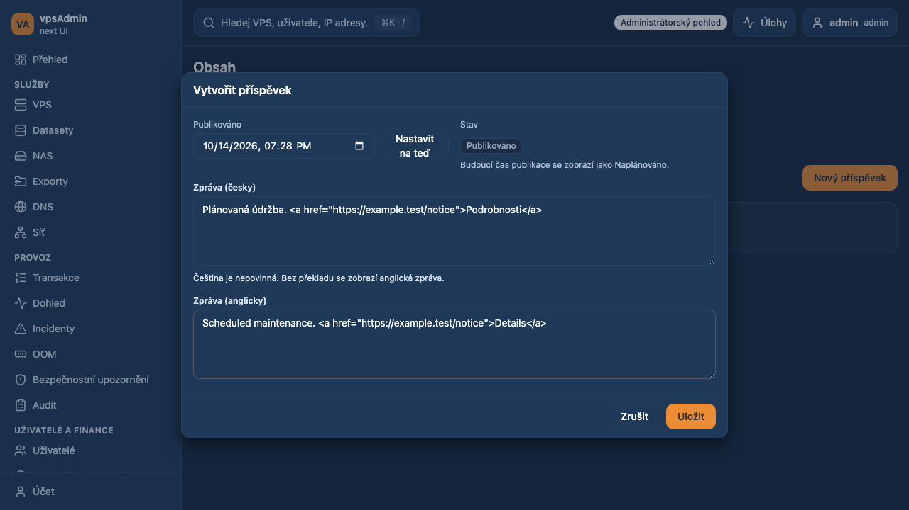
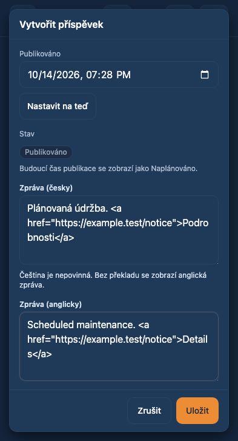

# Bilingual news editor — 2026-10-14

Requirement: REQ-053. Prepared on `dev/bilingual-news-editor` from `cce6814`.
Not merged or deployed. The API/backend is unchanged.

## Problem and change

The admin news modal exposed only the localized `message` and sent that
read-only field back on create/update. The current backend expects language
fields. Creation and editing now show separate Czech and English textareas,
preload exact translations, require English, and send `cs_message` and
`en_message` under `news_log`. Empty Czech removes its translation and readers
fall back to English. Missing explicit English is left blank instead of copying
a potentially Czech `message` into it. Both drafts survive failed saves.

The admin list previews the selected UI language and searches both translations
on the loaded page. Publication dates, scheduling and delete flows are retained.

## Contract and localization evidence

Read `docs/agent-instructions/localization.md` and the terminology/instructions
at vpsAdmin input revision `a65a4dfeb92a59df4a80a737a20bcbf8558793ff`, resolved
from this checkout's `flake.lock` (`vpsadminServices`). Nix is unavailable locally;
this was disclosed and the exact locked Git objects were read with `git show`,
not the sibling checkout's different HEAD. Inspected locked
`plugins/newslog/api/resources/news_log.rb`, its model and legacy
`webui/forms/cluster.forms.php`: English is the required default, all configured
translations are returned, and an empty Czech update deletes that translation.

No runtime lookup of API language metadata or backend/catalog changes were needed.
The frontend supports Czech and English. The separate KB may need refreshed
news-editor captures after accepting this PR; synthetic screenshots below do not
certify KB live capture or a deployed API.

## Verification

Passed `npm run ci:quick`, `npm test` (296 files / 1,794 tests),
`npm run test:scripts` (226 tests) and `npm run build` (existing chunk-size warning).
`npm run docs:inventory` produced no inventory changes.

Playwright: admin news + content deletion feedback, Chromium and mobile Chrome,
10 tests passed; after fixing the date-row overflow found in screenshot review,
all 6 news tests passed again. Commands used `E2E_START_SERVER=1`,
`E2E_BASE_URL=http://127.0.0.1:5198`, and `node scripts/playwright.mjs test`
with `e2e/specs/app/admin_newslog.spec.ts` and initially
`e2e/specs/admin/admin_content_delete_feedback.spec.ts`.
The touched news spec was adopted into strict E2E TypeScript coverage
(48 adopted / 208 deferred); reconcile counters with concurrent PRs at merge.
No declared hook framework or custom Git hook path was found.

Browser tests use synthetic HaveAPI responses and never publish real news. They cover both UI languages on desktop/mobile, separate
create/update payloads, HTML preservation, English validation, empty Czech,
reopening edits, save failure/retry, and safe handling of missing translations.

Local toolchain uses official Node 24.21.0 / npm 11.19.0, matching the locked
versions, because Nix is not installed. No production or dev deployment was made.

## Visual review

Implemented modal, Czech UI, synthetic data; no production records.
Date controls stack on narrow screens to avoid clipping the set-now button.

