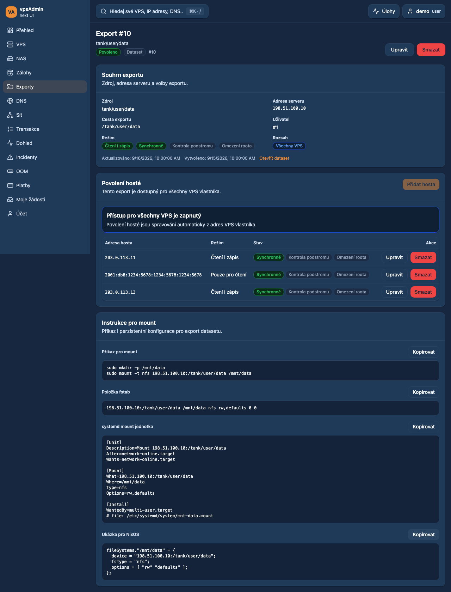
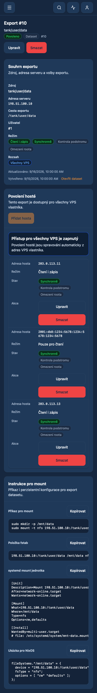

# Export mount command copy placement — 2026-10-16

Prepared correction to REQ-048; not merged or deployed.

Move the mount command's copy action out of the instructions card header and
place it beside the Mount command heading, matching fstab, systemd and NixOS.
Reuse `common.copy` (Czech: Kopírovat; English: Copy) and retain the compact
button, existing clipboard behavior, and snapshot-only instructions.

The locked vpsAdmin terminology and localization guides were read at revision
`a65a4dfeb92a59df4a80a737a20bcbf8558793ff`. No catalog, API, or payment data changes.

## Verification

- Pinned `nix develop` on the build host (Node 24.21.0 / npm 11.19.0):
  `npm ci`, `npm run ci:quick`, `npm test` (1,810 tests in 297 files), and
  `npm run build` passed. Design and active-documentation audits also passed
  locally after adding this entry.

- Existing `export_hosts_responsive_actions.spec.ts`: 12 passed across desktop
  Chromium, Pixel 5 Chromium and iPhone 13 WebKit. Covers selected-host,
  all-VPS and snapshot exports, responsive layout and exact copied snippet text.
- Screenshots below are the implemented local UI with synthetic API/clipboard
  fixtures, not authenticated production or live API certification.

