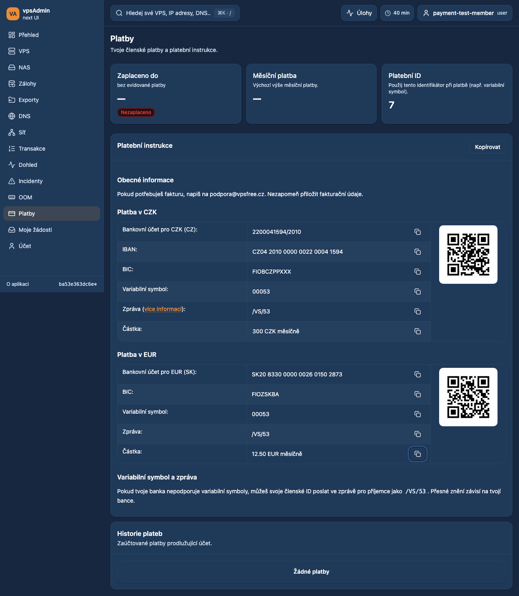
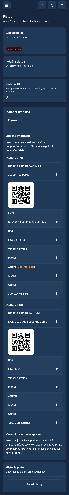

# Payment guidance: informal Czech across HTML whitespace

Requirement: REQ-052.

## Request and cause

The maintainer still sees formal Czech address in the variable-symbol/message
help in Payments. The previous frontend conversion matched literal spaces inside
sentences. Wrapped HTML, tabs or non-breaking spaces therefore bypassed it.
Three new regression cases reproduced that gap before the fix (all failed).
This reproduces a frontend failure mode; the exact authenticated production HTML
was not captured, so its formatting is not claimed independently verified.

## Change

Match whitespace within the three existing known Czech sentence patterns flexibly.
Keep inline code, member IDs including leading zeroes, and unrelated HTML intact.
Both rendered and whole-instructions clipboard text use this conversion. English
mode is unchanged. No API, configuration or payment data changes.

Terminology guide: locked vpsAdmin input
`a65a4dfeb92a59df4a80a737a20bcbf8558793ff`, read for the preceding localization
change in this task; this checkout has the same lock. The maintainer explicitly
requests informal Czech address.

## Verification and status

Prepared for review; not merged or deployed.

- Before fix: all three whitespace regression cases failed.
- After fix: 34 focused payment model/renderer unit cases passed.
- Six Playwright cases passed: Czech/English in desktop Chromium, mobile
  Chromium and mobile WebKit, using synthetic payment HTML with wrapped lines.
  Covers informal guidance, contact selection, per-value copying, copy failure,
  QR node stability and no document overflow. This is fixture evidence.
- Pinned Nix `npm run ci:quick`, full `npm test` and `npm run build` passed.
  Local design-documentation audit and `git diff --check` passed.

Implemented fixture screenshots:

## Deployment outcome

Merged and deployed to all three WebUI sites as clean `f2ad625d` on 2026-10-16.
See the [release receipt](2026-10-16-about-payments-release.md) for exact revisions,
CI, build, browser evidence, configuration pin and rollback. This supersedes the
prepared status recorded above.
