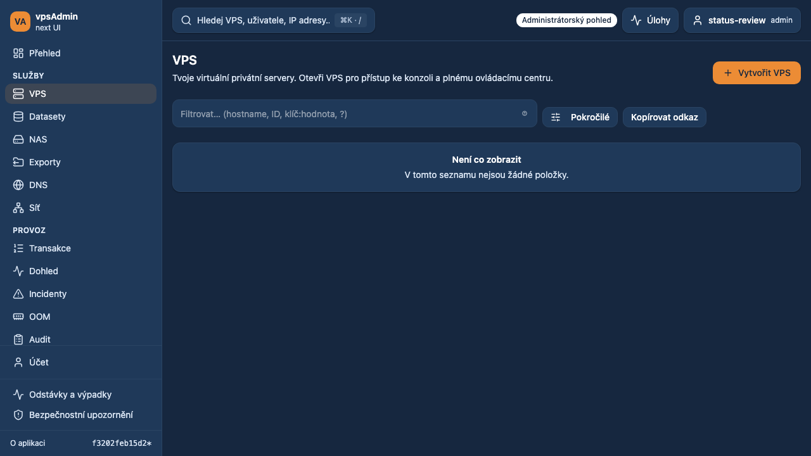
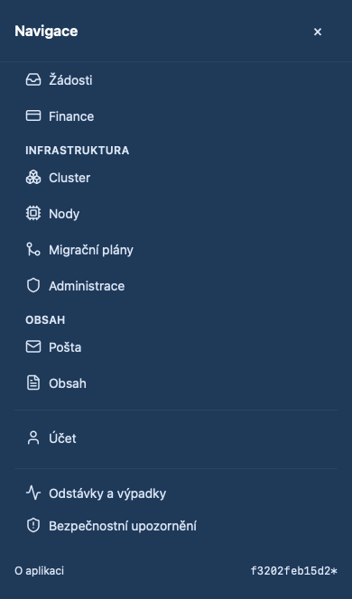

# Signed-in status navigation — 2026-10-16

The maintainer could not find outages or security advisories while signed in and
requested a separate block near the bottom of navigation, above About, with an
administrator entry point for creating outages (REQ-054/055).

## Implementation

- Both links appear in a separated footer block on desktop and in the mobile
  drawer, using existing navigation styling and icons.
- Members and privileged accounts in My view open existing public read-only
  pages. Administrator view opens the existing outage management page with its
  New outage/create/review flow; support retains read-only access.
- Advisory management remains admin-only. Support uses the public list. Removed
  the duplicate advisory entry from the Operations group.
- No API, routes, mutation semantics or publication permissions changed.

Terminology: read both guides from locked vpsAdmin revision
`a65a4dfeb92a59df4a80a737a20bcbf8558793ff`, resolved through the builder's Nix
input. Czech combined outage navigation says “Odstávky a výpadky”.

## Verification

Prepared locally, not merged or deployed. Browser evidence uses local application
code and synthetic HaveAPI data, not real outage publication. The footer fixture
covers members, admins in My view, admins and support, CS/EN, desktop Chromium,
mobile Chromium and iPhone WebKit; it opens the admin creation form without
submitting a real outage. See completion results below.

KB impact: inspected the separate KB change workflow and navigation contract.
That contract tracks the legacy PHP vpsAdmin/gettext/landmark source, not this
React repository. No legacy source revision was changed. New-UI sidebar captures
are provided here; external production KB screenshots were not regenerated or
certified by these fixture checks.

## Local results and implemented screenshots

All 24 footer browser scenarios passed with no retries. Type checking, adopted
E2E type coverage, i18n parity, structural budgets, lint/format checks, production
build and documentation audit passed. The navigation unit suite passed 19 cases; the complete unit suite passed 1,837
cases in 298 files using Node 24.21.0 locally.

Synthetic desktop administrator navigation:

Synthetic mobile WebKit navigation:

[Member navigation](screenshots/2026-10-16-status-sidebar/desktop-member.png) and
[admin outage creation form](screenshots/2026-10-16-status-sidebar/mobile-create-outage.png)
use the same isolated fixtures; no real outage was published.

## CI inventory correction

[PR #62](https://github.com/vpsfreecz/vpsadmin-webui/pull/62) initially failed
[run 38967129016](https://github.com/vpsfreecz/vpsadmin-webui/actions/runs/38967129016)
because two script tests still expected 55 adopted E2E files. The new
`sidebar_status.spec.ts` was already included in both the coverage inventory and
the TypeScript roots, bringing the actual compiler closure to 56. Updated both
assertions and the test description to 56; the 204 deferred files and all coverage
checks remain unchanged. No runtime behavior changed.

Verification: the complete local `npm run ci:pr` passed, including quick audits,
script/BFF/unit tests and the production build. The production dependency audit
also passed. Replacement GitHub CI is checked after pushing this correction.
Local Nix is unavailable; verification uses the matching upstream Node 24.21.0 /
npm 11.19.0 toolchain with `npm ci`, checked by `env:locked`. No declared hook
framework or custom `core.hooksPath` is present. This correction is prepared for
the existing PR; it is not merged or deployed.

## Combined-candidate review — 2026-10-18

The combined candidate (PRs 61/62/64/65/66 and non-draft ETNyx PRs 53/54/57)
exposed a timing-dependent test assertion on mobile WebKit. The advisory list
correctly adds `?limit=50&page=1` after navigation, while the footer test required
an exact URL ending immediately after the pathname. Check the exact pathname
instead, for both footer destinations, preserving route and drawer assertions.
This changes only test expectations, not routing or application behavior.

All 24 footer scenarios passed after the correction on desktop Chromium,
mobile Chromium and mobile WebKit. The original combined run passed the other
203 cases; its sole failure was this URL assertion. No PR was merged and no
production deployment was performed during this review.
