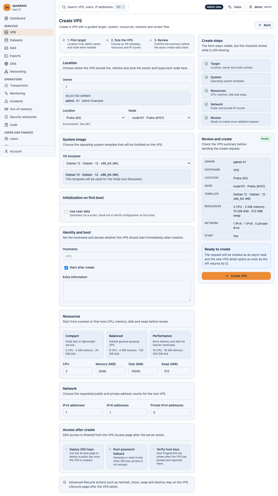
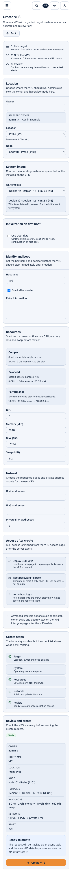

# Default hostname when creating a VPS — 2026-10-16

Prepared for review; not merged or deployed. Requirement: REQ-023.

The maintainer requested `VPS` as the initial and empty-input hostname. Creation
now shows it as a placeholder and resolves empty or whitespace-only input to
the same value. Per the follow-up request, typing starts in an empty field
without deleting a prefilled name.
Review, validation and the create payload use one resolver; the durable outcome
receipt and task label use the resolved payload hostname. This prevents recovery
from tracking an empty identity when the API received `VPS`.

Custom names retain their case, outer whitespace trimming and format validation.
Existing VPS edit, reinstall and clone behavior is unchanged. No API changes.

## Verification

- Pinned Nix development environment: all `ci:quick` checks passed (the E2E
  type gate was rerun after adoption), 1,814 unit tests passed in 297 files,
  and the production build passed. Documentation audits passed locally.
- Adopted the modified create-flow spec into strict E2E type coverage and
  updated its inventory-count assertions; 25 coverage/type-tooling tests passed.
- Initial checks caught the frozen structural exception on the large wizard
  primitives file. The final change resolves the review hostname in the page
  before passing it to the existing card, leaving that component unchanged.
  Structural limits and exception approvals were not relaxed.

- Playwright `vps_create_admin_flow.spec.ts` and `vps_create_failures.spec.ts`:
  50 passed on desktop Chromium and mobile Chromium. Added cases cover default,
  cleared, whitespace-only and custom names for members and administrators,
  checking the review, submitted body and durable receipt agree.
- Unit coverage checks initial state, empty input in both modes, trimmed custom
  names and invalid non-empty names. Existing accepted-binding component tests
  type directly into the initially empty field.
- Screenshots show the local implementation with synthetic API fixtures. No live
  VPS was created; browser evidence does not certify real API provisioning.

## Placeholder follow-up

Updated the same PR after the maintainer requested immediate replacement while
typing. Both language catalogs show the literal hostname `VPS`; the locked
terminology guide reviewed in this conversation is
`a65a4dfeb92a59df4a80a737a20bcbf8558793ff`. Browser cases now type a custom name
with real keystrokes without clearing the field, and test clearing a previously
entered name to exercise the fallback.

Follow-up verification passed: 16 targeted Playwright hostname cases on desktop
and mobile Chromium; pinned Nix TypeScript/E2E checks, i18n/design audits,
1,814 unit tests and production build. UI-string and active-documentation audits
also passed. Updated screenshots show the final placeholder implementation.
