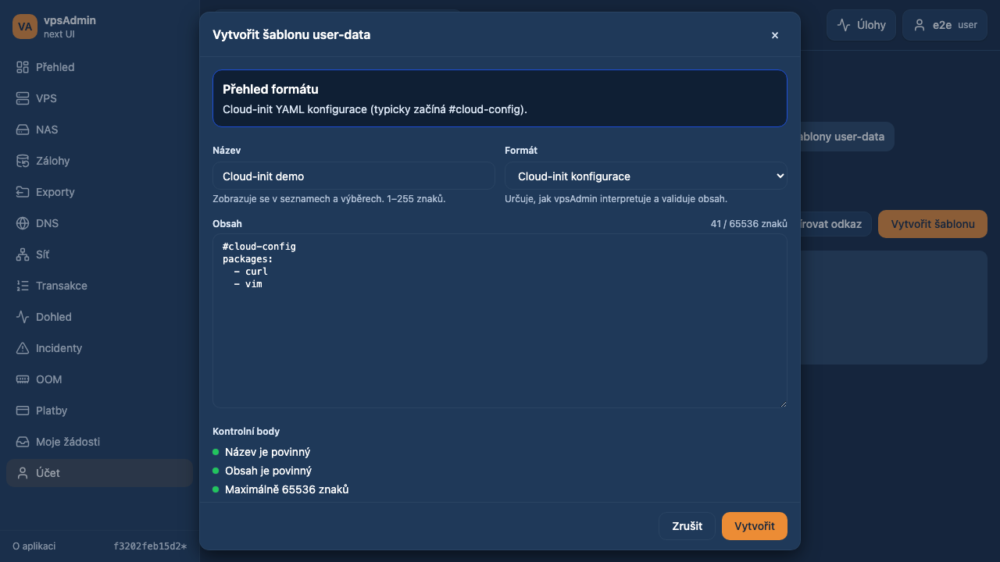
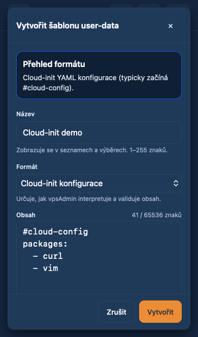
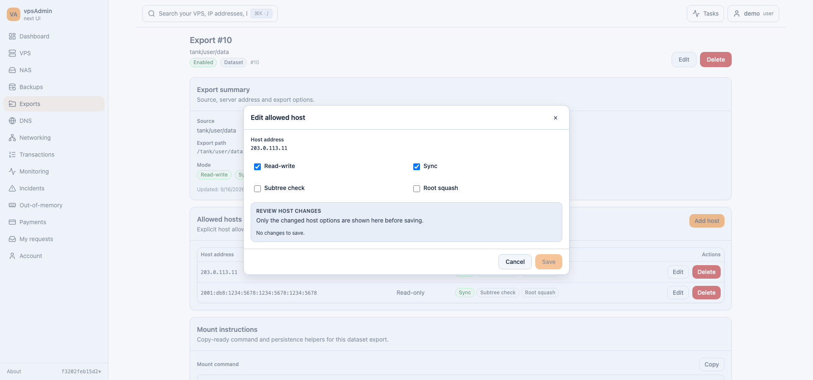

# Centered forms and advanced filters — 2026-10-17

Requirement: REQ-010. Status: prepared for review, not merged or deployed.
Review: [PR65](https://github.com/vpsfreecz/vpsadmin-webui/pull/65),
implementation commit `aebf36e9`.

## Request and change

The maintainer reported the user-data editor opening as a left drawer and asked
for centered dialogs consistent with the rest of the UI, plus a broader audit.
Source inspection found the shared Drawer defaulting to the left in 32 product
consumer files. Migrated forms and advanced filters to Modal: user-data
create/edit/deploy and filters, export/host editing, member editing, namespace
maps and advanced filters across VPS, datasets, DNS, incidents, OOM, transactions,
actions, monitoring, members, requests, IPs, migration plans, cluster, mailer,
audit and member history. The member editor previously opened on the right; it
now follows the same form convention. Mobile navigation, ongoing Tasks and
read-only lifecycle history intentionally remain side panels, as does the
component sandbox. The overlay audit enforces that boundary.

Modal has an opt-in labelled Close button with existing touch-target sizing.
Template editor/deploy actions stay in a non-scrolling footer. No API calls,
mutation contracts, pending guards, translations or labels are changed.
Historical `.drawer` test IDs stay stable to avoid breaking existing clients.

## Verification

- Deployed dev bundle: reproduced the template editor with `data-overlay=drawer`;
  it fails the new centering contract, as expected before deployment.
- Candidate on `https://dev.crucio.cz`: **94 passed, 2 skipped** (desktop skips
  touch-only journeys), with Chromium, Pixel 5 Chromium and iPhone 13 WebKit.
  This includes 27 advanced-filter routes in each browser, cs/en template
  editor/filter geometry, export-host editing and first-tap user/node lookups.
- Separate local advanced-filter sweep: **27 passed** in Chromium.
- Local template/export/mobile workflow regression: **50 passed, 10 skipped**
  (touch-only cases excluded from desktop), three browsers, no test retries.
- `npm run ci:pr`: audits, strict typechecks, 226 script tests, 57 BFF tests,
  1,832 unit tests and production build: **passed**. Known non-fatal large-chunk
  warnings remain.

Browser tests use synthetic accounts/API responses;
they do not certify backend mutation behavior. Dev-origin testing distinguishes
the deployed bundle from a candidate loaded only by the test browser. No shared
server deployment or real user-data mutation is needed for this layout change.

The dev harness intercepts only inside its isolated browser: a synthetic BFF
session, HaveAPI fixtures, and candidate `dist` HTML/assets (including the `/`
freshness probe). All shared dev services remain on their original release.
Initial harness runs exposed missing session bootstrap, inconsistent candidate
index/freshness responses and empty-object list fixtures; these were corrected
before the successful sweep. Dev HTTPS verification was disabled for the known
test-host certificate mismatch. This is browser/layout proof, not live API
mutation proof or a physical iPhone test.

The new strict E2E spec is registered in both the compiler and coverage manifest;
the exact adoption-count assertions move from 55 to 56 together. Existing
structural debt entries have reviewed presentation-only content hashes and
unchanged or smaller line allowances; no limit is raised. WebKit's `Load failed`
transport wording is accepted alongside Chromium's error wording, with the
existing one-request/reload lock assertions retained. Focus restoration is
asserted for keyboard/desktop activation; Safari touch does not focus the opener.
Geometry checks wait for the asynchronous visual-viewport resize event, without
retrying the user activation or test.

## Screenshots

Implemented candidate, dev origin, synthetic data; desktop 1280×720 and mobile
390×664 CSS pixels. The export capture uses a wider desktop viewport.

Toolchain: local Nix is unavailable; used Node 24.21.0/npm 11.19.0 matching the
locked development toolchain, with clean `npm ci` at root and in `bff/`.
No declared hook framework/core.hooksPath was found. Production deployment,
merge and real API changes are outside this prepared PR.
