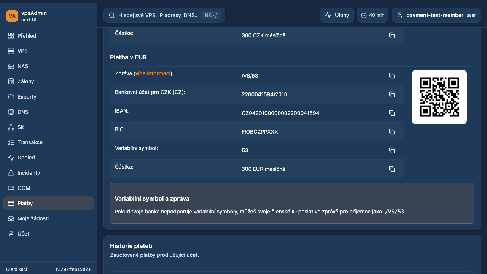
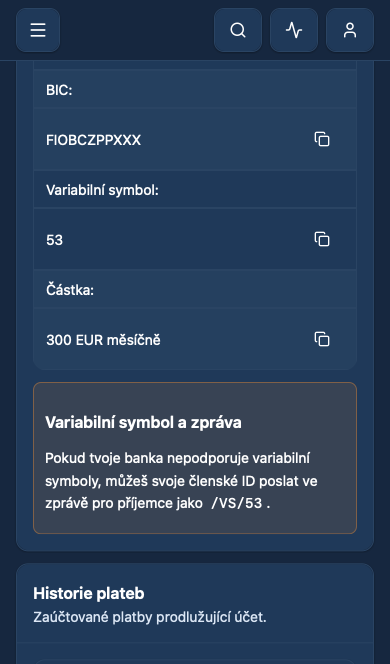

# Payment message help — 2026-10-17

The maintainer reported that message-row “more info” links did not visibly help
and requested a brief highlight of the explanation plus removal of the redundant
Czech bank-dependent wording sentence (REQ-052).

The payment sanitizer intentionally strips arbitrary source IDs/names. The React
renderer now recognizes the CS/EN message explanation, creates an instance-local
help target, and connects its fragment links. Activation focuses and scrolls to
the help, then highlights it for three seconds; another activation restarts the
timer. Reduced motion uses immediate scrolling and no color transition. Memoized
content preserves decoded QR nodes. External links remain external. No API,
bank details, QR payload, payment mutation or deployment changes are included.

The visible Czech sentence and whole-instructions clipboard conversion omit the
bank wording suffix, preserving inline member reference code and informal voice.

Terminology: local Nix is unavailable. Read both guides from the exact locked
vpsAdmin revision `a65a4dfeb92a59df4a80a737a20bcbf8558793ff` through GitHub's
contents API, without substituting a floating branch. Tests use matching upstream
Node 24.21.0 / npm 11.19.0. Read the separate KB workflow; its PHP/gettext source
contract does not cover this React renderer. No legacy revision changed, and
external published KB screenshots are not certified by these fixtures.

## Verification

- `npm run ci:pr` passed: quick audits, typechecks, 226 script tests, 57 BFF tests,
  1,833 unit tests across 298 files and production build.
- All 30 payment Playwright cases passed without retries on Chromium, mobile
  Chrome and iPhone WebKit. Coverage includes CS/EN, dark/light, both motion
  preferences, keyboard/touch activation, focus/scroll/highlight expiry, copying
  and QR image-node stability. These are local synthetic fixtures, not live API
  or production deployment evidence.
- The component test also checks independent targets in two rendered instances,
  timer restart, and preservation of external URLs and QR nodes.
- No custom Git hooks or declared hook framework were found.

Prepared for review, not merged or deployed.

