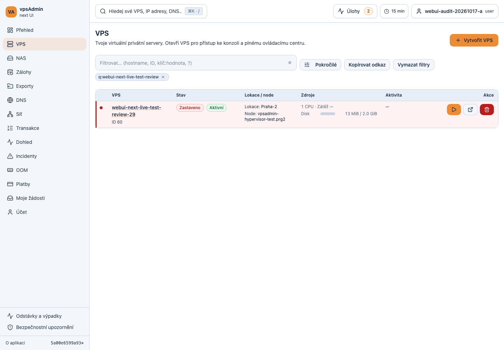

# Combined PR review and development API verification — 2026-10-18

## Scope and publication state

The maintainer approved our work for review and requested security review and
combined dev testing of ETNyx's non-draft proposals before a possible joint
release. No upstream merge or production deployment is authorized by that
review approval. The isolated local integration branch is
`dev/review-combined-20261018`, based on upstream main
`f3202feb15d21eb436594ee9f2b69f221d51932b`.

| PR | Reviewed head | Scope |
| --- | --- | --- |
| [61](https://github.com/vpsfreecz/vpsadmin-webui/pull/61) | `125fbb269bcc639df0e19ade81bfc7042dff1dd8` | Deployment Git identity instructions |
| [62](https://github.com/vpsfreecz/vpsadmin-webui/pull/62) | `fb672f670450503af2f3ac9beb6a5a0c9b57c056` | Separate signed-in outage/advisory navigation |
| [64](https://github.com/vpsfreecz/vpsadmin-webui/pull/64) | `77a72d3dcfb352baae1a64caaaa2355d65d7719d` | Payment message help and wording |
| [65](https://github.com/vpsfreecz/vpsadmin-webui/pull/65) | `3732849c6b992244b26714629b9fa476d2dd644e` | Centered forms and advanced filters |
| [66](https://github.com/vpsfreecz/vpsadmin-webui/pull/66) | `7110b8072a7d999e173af2867c98ff3d4b2be925` | Expired VPS renewal/reactivation |
| [53](https://github.com/vpsfreecz/vpsadmin-webui/pull/53) | `85b47b2a72a48ffa91a6beaf3532614bfd200f4c` | Filter chips below aligned controls |
| [54](https://github.com/vpsfreecz/vpsadmin-webui/pull/54) | `7ced36d37b6982bd6b59de7c17363b39346a305b` | Seven-day failed-chain indicators and links |
| [57](https://github.com/vpsfreecz/vpsadmin-webui/pull/57) | `f836762af6efd66e1ddfcb51d7a1ff8bfc18ef09` | RAM/disk badges in VPS detail |

Draft [63](https://github.com/vpsfreecz/vpsadmin-webui/pull/63),
`1c4c0f7f66f9c660e86df901fac9ec49b859a6e3`, is excluded. Its additional
per-detail failed-chain polling is not present. Local merge commits retain the
original PR authors. The integration branch was not pushed. PR 62 alone received
a test-only correction discovered during this review; no ETNyx branch was edited
and no review/comment was sent to its author.

The integration resolves overlapping VPS list/semantics changes from 54 and 57,
keeps both workflow requirements, combines the adopted E2E inventory (60 adopted,
203 deferred), retains the new WebKit scenarios and updates structural hashes
without increasing allowances. These resolutions must accompany any eventual
merge sequence; passing independent PR checks alone does not verify that sequence.

## Security assessment

No new exploitable security defect was found in the reviewed changes. This is a
bounded change review and live authorization check, not a security certification
of the entire application or backend.

- **53:** layout-only changes to shared filter controls and their consumers.
  Input parsing, filters sent to the API, permissions and mutations are unchanged.
  Long chip text stays inside the viewport in the regression fixtures.
- **54:** operation text is rendered through React text/attributes; no new raw
  HTML sink is introduced. The badge links to the existing internal transaction
  detail using the chain ID and the current application/admin prefix. Existing
  nested-link handling prevents clicks or Enter from opening the parent VPS row.
  Failed/fatal fetches use the existing authenticated API adapter and query key.
  Actual member sessions could not read another member's VPS or creation chain,
  nor an unrelated failed chain visible to an administrator.
- **57:** one shared numeric usage rule and badge component is used by the list
  and detail. Non-finite ratios and missing/nonpositive capacities do not produce
  badges. Warning begins at 90%, danger at 98%. No extra API request, action,
  permission or authentication path is introduced.
- The three ETNyx proposals do not change dependencies, lockfiles, GitHub
  workflows, BFF code or API code. Existing mutation/authentication gates remain
  in use. Combined mutation, CSP, overlay, localization, structural and type
  audits passed, as did BFF tests and the real-browser redirect guard regression.

### Functional qualifications for PR 54

The seven-day window is measured from **chain creation**, not the instant a
transaction failed. An older chain which fails today can therefore be omitted.
This matches the proposal's explicit behavior, but should not be described as
"all failures from the last seven days" without that qualification.

The existing fetch cap remains 200 failed plus 200 fatal chains. A missing badge
is not proof that a VPS has no unresolved failure; old chains and records outside
that cap remain available through transaction views. Fetch errors also do not
create a separate badge. These are monitoring/completeness limitations, not a
new authorization bypass. Historical failures disappearing from the VPS's red
row tone is the intended change, not deletion of history.

## Verification

Toolchain: upstream Node 24.21.0 / npm 11.19.0 matching the lock check, since local
Nix is unavailable. The initial older local Node/npm pair was rejected by the
lock check and was replaced before the recorded successful run.

- `npm run ci:pr`: passed quick audits, script tests, BFF tests, all **1,854 unit
  tests in 300 files**, and the production BFF-mode build.
- `npm run test:scripts:browser`: passed the real-browser API/static redirect
  containment regression.
- Eight targeted Playwright files covered desktop Chromium, mobile Chromium and
  the configured mobile WebKit cases: filter alignment, VPS row navigation and
  failure links, header usage badges, centered dialogs, user-data templates,
  status footer, VPS reactivation, and payment QR/help interactions.
- Initial combined run: **203 passed, 1 failed**. The failure was PR 62's exact
  URL assertion racing with advisory pagination (`?limit=50&page=1`), not failed
  navigation. The correction checks the exact pathname. All **24 footer cases**
  then passed across the three browsers. The other 180 scenarios had passed in
  the combined run. No failure was hidden with retries or skipped assertions.
- The correction was pushed to PR 62 as `fb672f67`; its E2E type check and design
  audit also passed. The local combined candidate after that merge is
  `cea10e24d319aeca2aadd9fb71119b3d568f15c2` (use the branch's full commit identity when preparing a release).

### Real development API evidence

Playwright used `https://dev.crucio.cz` with real OAuth sessions and live API
requests. Only frontend HTML/hashed assets were served from the combined local
build through Playwright routing. The root HTML freshness probe was served from
that same build as well; initially overlooking this probe caused test-only reload
loops and was corrected in the harness. No API/authentication response was mocked.
The legacy-mode build used for this dev check has the same runtime source as
`5a00e6599a93176ca02c87e62841556d12151969`; the only intervening uncommitted change
at build time was the footer test correction. The clean integration commit
`cea10e24` adds that correction and its documentation, not runtime changes.

The shared dev release, BFF process and both production instances were not
replaced. This is live API verification of a browser-injected candidate, not
proof of deploying that candidate.

Two previously created disposable member accounts (29 and 30) and the isolated
test administrator (31) were temporarily unlocked. New disposable VPS 60/61
were created with no IP allocation, 1 CPU, 1 GiB RAM and 2 GiB disk each.

- Both members could retrieve their own VPS; the other member's VPS returned
  HTTP 404. Anonymous access returned HTTP 401.
- Own creation chains 351/352 returned HTTP 200; the opposite member's chain and
  unrelated failed chain 227 returned HTTP 404. Failed-chain list results were
  restricted for the members; administrator visibility provided the positive
  control for chain 227.
- Desktop Chromium, Pixel/Android Chromium and iPhone WebKit opened the owned
  VPS on first activation, displayed filter chips, created a real owned script
  template through the centered editor, and followed both status footer links
  on first activation. No JavaScript exceptions or horizontal document overflow
  were observed in those tested flows.
- Real VPS 60 was placed into the suspended state through the existing lifecycle
  operation with a disposable expiration-regression reason and no reminder. The
  admin UI reactivated it and changed its expiration to 21 November 2026. The
  actual PUT contained `object_state` and `expiration_date`, omitted the absent
  `remind_after_date`, and returned HTTP 200. The subsequent start chain completed
  and the real API eventually reported `is_running: true`, `object_state: active`.
  This exercises the reported post-expiration state; it does not retest the
  supervisor's clock-driven expiration scheduler.
- The administrator's outage creation form opened; no outage was published.
- **Live payment help remains unverified:** this dev API has no payment
  instruction template configured. Its empty instructions were observed on
  desktop and iPhone. The full help/highlight/QR scenarios passed with fixtures;
  no global dev payment configuration was changed to manufacture a live result.
- High RAM/disk warning thresholds and recent/old failed-chain badges were
  exercised with fixtures. Real owned VPS data and authorization were used for
  navigation/renewal; no resource exhaustion or deliberate hypervisor failure
  was induced to manufacture those badges.

Implemented candidate with real disposable dev data:

[Mobile VPS list](screenshots/2026-10-18-combined-pr-review/iphone-vps-list.png),
[mobile centered editor](screenshots/2026-10-18-combined-pr-review/iphone-centered-editor.png),
and [renewed running VPS](screenshots/2026-10-18-combined-pr-review/admin-renewed-running.png).

## Development host housekeeping

The dev root filesystem initially had no usable free space for the BFF session
store. Before live login, inactive historical WebUI backups and the inactive
root npm content cache were moved to the spacious `/data` filesystem; original
paths were preserved as symlinks. No backup was discarded. Active process paths
were checked before moving the old backup directories. Existing VPS, databases,
release pointers, BFF credentials and server configuration were not moved or
edited. About 597 MiB became available to unprivileged processes on root; this
relieves the immediate test blocker but is not a long-term disk-capacity fix.

## Release decision

Recommend accepting non-draft PRs 53, 54 and 57, with the explicit seven-day and
query-cap qualifications above, alongside the maintainer's approved work after
integration checks. Production remains unchanged. Before merging/deploying,
recheck all heads, current main, permissions to run fork CI, the integration
resolutions and the intended release scope. ETNyx's GitHub workflows currently
require maintainer approval (`action_required`); they are not green GitHub runs.

## Cleanup and final CI snapshot

Cleanup chains 356/357 completed all 10 steps each. Both disposable VPS and all
`combined-review-*` templates were removed. Accounts 29/30/31 are locked again,
OAuth/token authentication is disabled and all their live sessions were closed.
A subsequent authenticated request with each revoked token returned HTTP 401.
Previously existing namespaces and account configuration were retained.

At the final review snapshot, PRs 61, 64, 65 and 66 had all six required checks
successful. PR 62's replacement run passed required nonbrowser checks, production
build, Chromium script regression and mobile WebKit; desktop/mobile Chromium
smoke were still running. See [CI](https://github.com/vpsfreecz/vpsadmin-webui/actions/runs/39158579392)
and [browser checks](https://github.com/vpsfreecz/vpsadmin-webui/actions/runs/39158579391).
ETNyx 53/54/57 have `action_required` workflows awaiting maintainer approval;
local combined checks must not be presented as green GitHub checks. Upstream
main was still `f3202feb15d21eb436594ee9f2b69f221d51932b` at the final recheck.
The deployed dev frontend and BFF still point to
`f2ad625d6b5b5ee1d59d650086173515e2fd0438` and both services are active.
