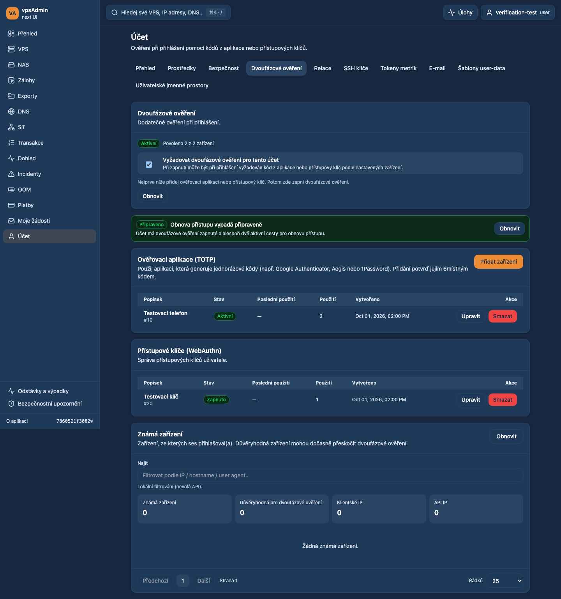
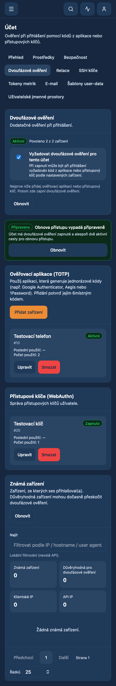

# Understandable account verification labels — 2026-10-19

Status: prepared for review, not merged or deployed. Requirement: REQ-040.

The maintainer could not find authenticator setup under the acronym MFA.
Rename the personal account tab (both views) and member-administration tab to
“Dvoufázové ověření” / “Two-step verification”. Explain verification through
app-generated codes or passkeys; the Czech TOTP section is now “Ověřovací
aplikace (TOTP)”. Keep TOTP searchable without making it the navigation label.
Use the same plain-language term in the shared requirement switch, disable
confirmation, notifications, recovery guidance and trusted-device explanations.
Technical keys, API inputs, routes, authentication and permission logic are
unchanged. The existing recovery browser assertion follows the renamed label.

## Verification

- `npm ci` using Node 24.21.0/npm 11.19.0 fallback; local Nix is unavailable.
- `npm run typecheck`, `npm run audit:i18n`, `npm run format:check`,
  `npm test` (300 files / 1,854 tests), `npm run build`: passed.
- Existing recovery, WebAuthn edit/delete and passkey handoff Playwright suites:
  eight Chromium cases passed, including explicit disable confirmation.
- Twelve rendered checks passed: Czech/English, desktop Chromium/mobile WebKit,
  member profile/admin profile/admin member detail. Checked active navigation,
  authenticator title and absence of horizontal page overflow.
- Browser evidence uses synthetic API fixtures, not a dev or production account.
  No security setting or real authentication device was modified.

Localization guides were read from the exact locked vpsAdmin revision
`a65a4dfeb92a59df4a80a737a20bcbf8558793ff` via Git because Nix is unavailable.
The KB workflow and `member.totp-devices` contract were inspected: that external
contract targets legacy PHP `webui/pages/page_adminm.php`, not this React UI.
Its legacy source/labels remain unchanged, so no legacy input pin was replaced
with a WebUI commit. This does not certify production KB pages/screenshots.

## Implemented UI, synthetic data

## CI follow-up — 2026-10-19

The required CI gate rejected the edited recovery spec because it was still in
its frozen deferred TypeScript inventory. Adopted that existing spec into the
strict E2E project, removed its deferred entry, and updated both inventory count
assertions (61 adopted, 202 deferred). No check or compiler option was relaxed.

Validation: `npm run ci:quick`, 16 type-coverage guard tests and all six recovery
browser cases across desktop/mobile Chromium passed. Changes only affect test
coverage configuration; the account labels and authentication behavior are
unchanged. GitHub checks will run on the updated PR head; no merge or deployment.
