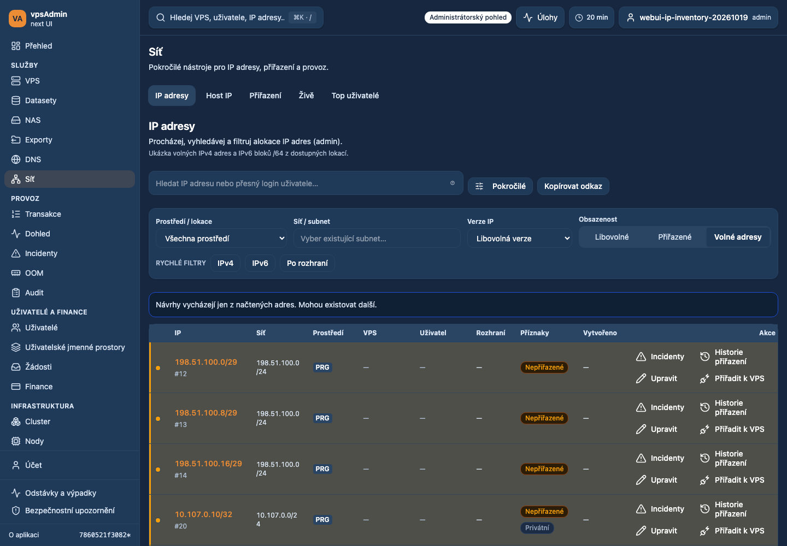
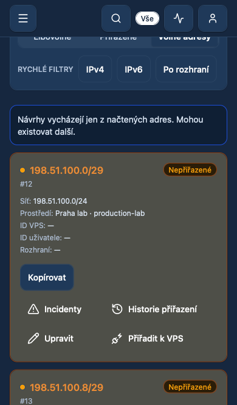

# 2026-10-19 — Free IP suggestions and readable inventory actions

## Request and behavior (REQ-050)

The default admin inventory suggested obsolete individual IPv6 addresses and
used five small, unlabeled action icons. Request IPv6 /64 blocks directly using
the existing prefix filter, rather than hiding /128 after fetching a page they
can fill. Defensively validate the returned prefix and isolate the cache key.
IPv4 suggestions and explicit inventory filters are unchanged. Existing prefixes
remain searchable and accessible; there is no API, allocation or network change.

Follow the legacy UI with four direct labeled links: Incidents, Assignment
history, Edit, and Remove from VPS (Assign to VPS when unassigned). Edit opens
the full IP detail with ownership and host-IP tools. Attach/detach targets its
routing section and retains the existing confirmation before removing an IP.
Use 20px icons, compact desktop controls and at least 44px touch targets, with
wrapping labels. Navigation alone never mutates routing or ownership.

## Verification and scope

Browser-local candidate assets on dev.crucio.cz
preserve its real server security headers and authenticated API. They do not
change the shared deployment. A disposable test admin is used only for read-only
inventory checks and navigation. After the final run, the account was locked,
OAuth/token authentication disabled and all sessions closed (zero open sessions). No service address, owner, route or host record is changed.

The dev stock has /124 test allocations, not free /64 blocks. Live checks can
verify the /64 query is accepted and legacy records remain accessible, but /64
selection and the old-ID-first regression require deterministic API fixtures.

Nix is unavailable locally. Checks use the pinned Node 24.21.0/npm 11.19.0.
Terminology reviewed at vpsAdmin input
`a65a4dfeb92a59df4a80a737a20bcbf8558793ff` via immutable GitHub source for both
`docs/i18n-cs.md` and `docs/agent-instructions/localization.md`.
The KB contracts workflow was reviewed: this admin inventory change affects its
screenshots/labels; no external KB capture refresh or publication is claimed.

The three changed E2E files are adopted into the strict TypeScript inventory;
its count assertions are updated together. Existing WebKit project selection
now covers the inventory cases, and test viewport assumptions include WebKit.

### Checks

- `npm run ci:quick`: passed (including localization, strict E2E typing,
  component contracts, overlays, mutation audit and formatting).
- `npm exec vitest run -- --maxWorkers=2`: 1,855 tests across 300 files passed.
  Bounded workers avoid unrelated timer-test contention on this workstation.
- `npm run test:scripts`: 226 passed; `npm run test:bff`: 57 passed.
- `npm run build`: passed; the existing large-chunk warning remains.
- `npm run audit:design-docs` and `git diff --check`: passed.
- Targeted Playwright run against local Vite: 42 passed, two intentional skips
  of the desktop-pagination case in mobile projects. Coverage includes inventory
  pagination and filters, exact user/address lookups, legacy IPv6 access, the
  four action links, keyboard activation, 44px mobile targets, and retryable
  failures in existing detach/host-delete confirmations. Projects: Chromium,
  mobile Chromium and mobile WebKit (the configured subset).
- Six focused fixture cases also passed against the dev origin with candidate
  assets: the early-ID /128 versus /64 regression, first-tap action navigation,
  and the progressive request budget, on all three browser projects.
- Authenticated real-dev runs passed on desktop Chromium and iPhone WebKit:
  all four links, explicit legacy /124 filtering, IPv4/IPv6 quick filters and
  clearing, plus the IPs, host IPs, assignments, live and top-user tabs. Each run
  accepted three IPv6 requests with prefix 64. No observed API errors or document
  horizontal overflow. These were read/navigation checks; actual route removal
  and ownership changes were not performed against shared dev resources.

The fixture cases simulate API responses. The real-dev runs use the actual test
API and temporary OAuth account. Neither method deploys candidate assets to the
shared server. Free /64 selection is fixture-verified because the live lab has
no free /64 pool. Existing /128 allocations are not hidden from explicit search.

### Screenshots

Captured implemented candidate assets on dev.crucio.cz, using actual isolated
lab inventory and the disposable test account (not production member data).

## Status

Review branch: `dev/ip-inventory-actions`, based on main `7860521f3082`.
Prepared for review; not merged or deployed. The shared dev and production
releases remain unchanged.
