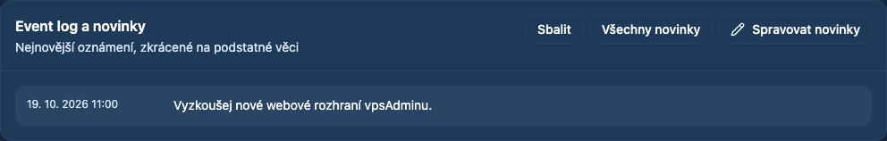
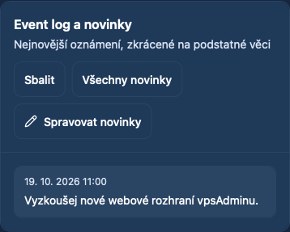
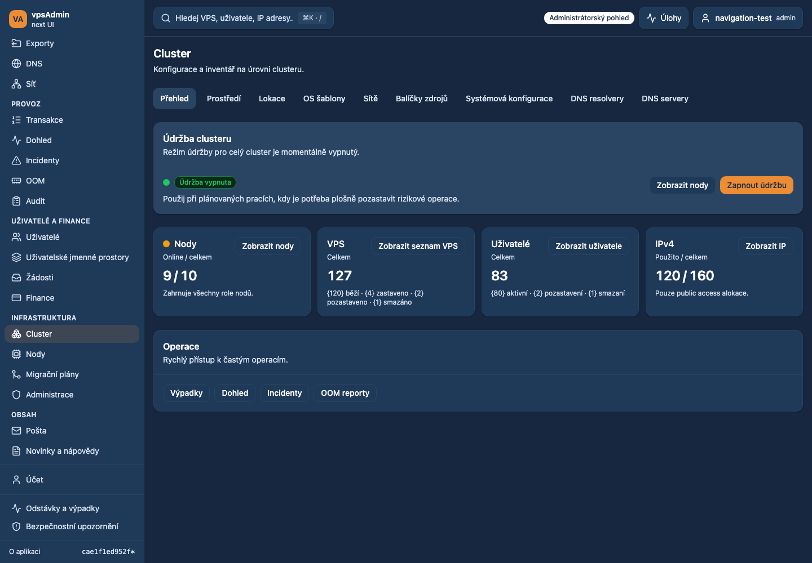
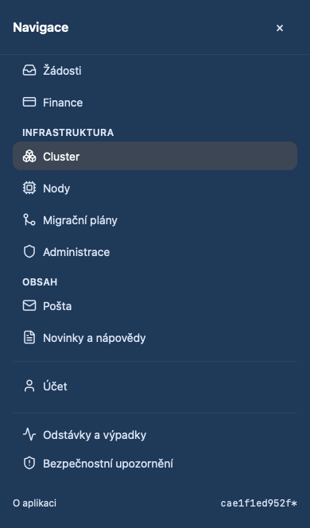

# Dashboard news management shortcut — 2026-10-19

Status: prepared for review, not merged or deployed. Requirement: REQ-053.

The maintainer requested a direct management action in the dashboard news card.
Previously the admin view silently reused “All news” for the management route.
The card now separates these intents: All news always opens the public reading
page `/news`; Manage news opens `/admin/content/news`. The latter is a small
secondary link with a pencil icon, shown only for role `admin` in admin view.
It uses the existing wrapping header, including at 320px, and stays available
when the news widget is collapsed. It creates no new route or API permission.

The existing news API restricts create/update/delete to administrators. Support
and members receive no management shortcut; administrators in My view do not
either. Navigation and opening the bilingual editor perform no news mutation.

Verification uses synthetic fixture API data, not a live deployment. Browser
coverage exercises Czech/English, desktop Chromium, mobile Chromium and mobile
WebKit, first-tap navigation, both editor language fields, the public reading
link, a collapsed widget, 320px width, and all three excluded role/view cases.
The existing admin dashboard spec is now adopted into strict E2E type checking.

Local Nix is unavailable; checks use the matching Node 24.21.0/npm 11.19.0
fallback with `npm ci`. Localization follows the previously read immutable
vpsAdmin guides at locked revision `a65a4dfeb92a59df4a80a737a20bcbf8558793ff`.
No API, server configuration, production data, merge or deployment changes.

## Navigation follow-up

The maintainer requested removing duplicate content links from Cluster and
renaming the vague Content destination. The Cluster content card is removed;
Operations fills the available row. Desktop sidebar, mobile drawer and the
content administration heading now use “Novinky a nápovědy” / “News and help”.
The generic sidebar group heading still covers mail as well as news/help.
Routes, permissions and editor behavior are unchanged. This extends
[PR #71](https://github.com/vpsfreecz/vpsadmin-webui/pull/71).
Rendered checks passed for both languages in desktop Chromium and mobile WebKit:
no duplicate Cluster card, correctly named navigation, successful navigation to
the existing news page and matching title, with no horizontal overflow.

## Checks

- `npm run ci:quick`, `npm test` (300 files / 1,854 tests),
  `npm run test:scripts` (226 tests), and `npm run build`: passed.
- Focused Playwright: 18 cases across desktop Chromium, mobile Chromium and
  mobile WebKit passed; final Czech-locale screenshot run rechecked all 12
  desktop Chromium/mobile WebKit cases, including 320px navigation.
- Navigation follow-up: `npm run ci:quick`, all 1,854 unit tests, and build
  passed. The existing dashboard and Cluster maintenance Playwright suites
  passed all 16 desktop/mobile Chromium cases. Four additional rendered checks
  passed in Czech/English on desktop Chromium and mobile WebKit.
- Local BFF dependencies were installed for the script suite; no BFF source changed.

## Screenshots

Implemented candidate, synthetic data, Czech dark theme:

Navigation follow-up (synthetic data):

