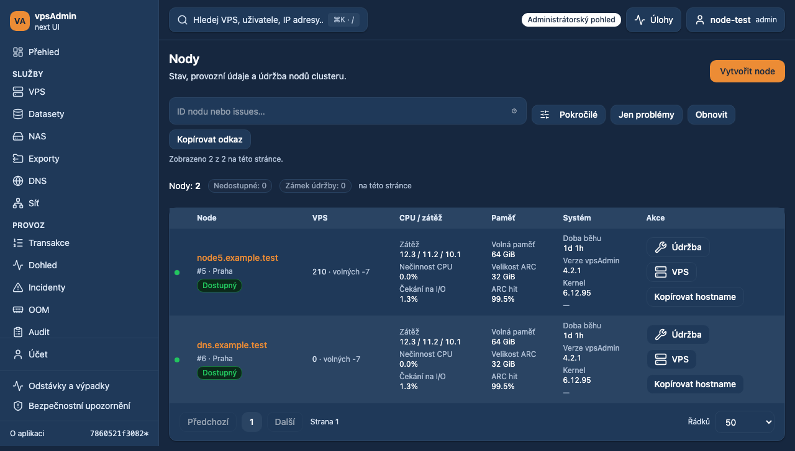
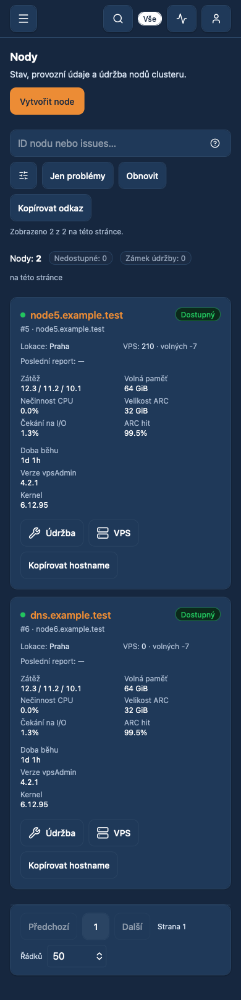
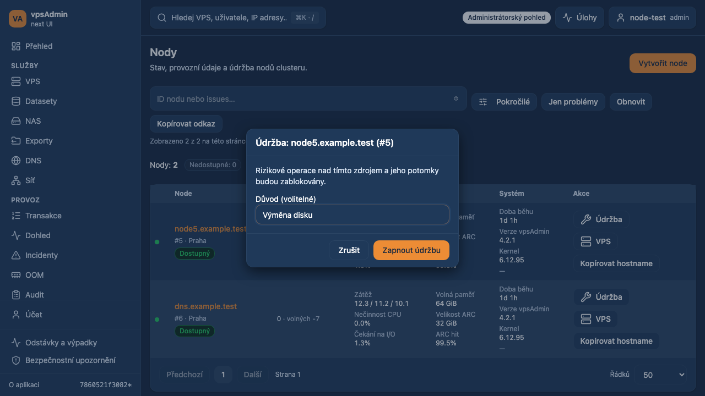
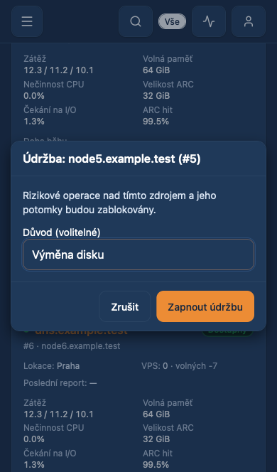

# 2026-10-19 — Node inventory and maintenance controls

Prepared for review on `dev/nodes-maintenance-overview`, based on canonical main
`7860521f30826c3886c89c35e8ab6f4e082e0a4b`. Not merged or deployed.
Requirements: REQ-001, REQ-026, REQ-028.

## Problem and implementation

The node inventory joined authenticated identity with public status, ignoring
metrics already returned by the authenticated API. DNS and other non-public
nodes therefore appeared unknown. The old PHP cluster table uses
`GET /nodes/overview_list`; the new admin inventory now enriches the existing
paginated `/nodes` list with that same action, matched by ID. This is one overview
request, not a detail request for every node. Support users retain the limited
index/public-status contract and never request the administrator overview.
Failures retain the available inventory with a visible warning. Missing values
remain unknown, and zero/false/negative free-slot values are preserved.

The table groups node ID/location/status, running VPS/free slots, CPU/load,
memory/ARC, and system version/kernel/uptime. Memory and ARC are MiB in the API;
uptime is seconds. Mobile cards expose the same metrics without page overflow.
The summary is compact so it does not displace the node inventory on mobile.

Row actions have text labels: maintenance, VPS, copy hostname, and heatmap where
configured. The optional heatmap label applies only to this admin inventory;
other heatmap surfaces retain their current icon-only presentation. Node names
open details. Copy confirms success/failure, and VPS preserves the node filter.

Maintenance opens a centered confirmation with the exact node name and ID,
optional reason, and the existing reason when disabling. It reads the exact node
and probes OPTIONS before enabling confirmation, then rechecks permission and
state/reason immediately before POST. Inherited `master_lock` is explained and
cannot be removed from the child node. Administrator role and server permission
are both required. Concurrent duplicate submissions use a local mutation lock;
a changed lock/reason requires reviewing the refreshed state before confirmation.

`POST /nodes/:id/set_maintenance` is an existing synchronous action, with
`{node: {lock, reason?}}`; it does not enqueue an action-state task. Exact node
read-back verifies the outcome. A lost response is reconciled without repeating
the POST. An unverifiable outcome blocks further changes across dialog closing,
reopening, and pagination until explicit successful read-back. This guard is
query-session state backed by an exact durable local mutation generation.
Successful explicit read-back releases that same generation; it never clears
another action by object ID. Reloading loses the verification preview but leaves
the shared uncertainty guard for manual reconciliation. The API remains
authoritative and does not provide compare-and-swap maintenance updates.

## Verification and boundaries

- Local fixture tests cover desktop Chromium, mobile Chromium and mobile WebKit:
  first-tap opening, reason payload, lock/unlock, inherited lock, permission
  denial, concurrent changes, support visibility, ambiguous response recovery,
  persistent verification guard, overview failure, copy and filtered VPS link.
- Real `dev.crucio.cz` OAuth/BFF/API: candidate assets were substituted only in
  the test browser. Both desktop Chromium and mobile WebKit returned successful
  authenticated node inventory, overview, exact node read, and maintenance OPTIONS.
  Confirmation opened and permission was available; neither viewport overflowed.
  **No maintenance POST was sent to existing dev nodes.** This proves live reads
  and authorization discovery, not a live maintenance toggle or shared deployment.
- Reused the disposable test administrator with mail/notifications disabled.
  After the read-only check it was locked, OAuth/token authentication disabled,
  and all sessions closed (zero remaining open sessions).
- API source, API data model, deployed binaries and shared frontend are unchanged.
  No production action was performed. No claim of a production deployment.
- Local `nix develop` is unavailable. Verification uses the matching locked Node
  24.21.0/npm 11.19.0 toolchain and `npm ci`; no dependencies installed on servers.
- Localization guide revision: locked `vpsadmin` input
  `a65a4dfeb92a59df4a80a737a20bcbf8558793ff`. Its immutable terminology and
  localization guides were read using the documented non-Nix fallback.

Checks: `npm run ci:quick`, `npm run ci:tests` (300 unit files / 1,856 tests,
plus script/BFF suites) and `npm run build` passed. Focused browser tests
passed on desktop Chromium, mobile Chromium and mobile WebKit (24 cases).
The existing heatmap assertion now expects text only on the admin node inventory;
other heatmap controls retain their icon-only contract. The existing node
filter, keyset pagination, issue-filter, detail and heatmap regression suite
also passed (24 desktop cases).

## Screenshots

Implemented candidate with synthetic nodes, Czech dark theme. These images are
not production data or evidence of a deployed release.

