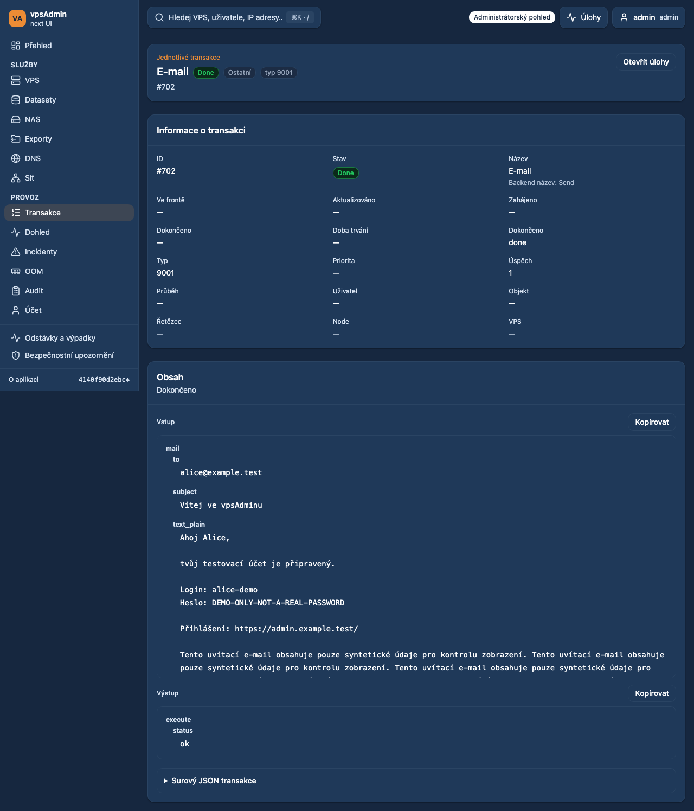

# Readable transaction payloads

Date: 2026-10-20. Requirement: REQ-051. Status: prepared for review;
not merged or deployed.

## Request and implementation

The maintainer reported a welcome email in transaction input reduced to one
horizontally scrolling line. The transaction item detail now stacks input and
output at full width. Input has a minimum height of 20rem and the existing
28rem large-scroll cap; excess content remains vertically scrollable and
keyboard focusable. Output sizes to its contents with the same upper cap.

A dedicated reader presents JSON fields and nested string values separately,
retaining real newlines/paragraphs and wrapping long identifiers. HTML in any
value stays inert React text. Plain text, malformed JSON and JSON with unsafe
numbers fall back to the original text to avoid corrupting identifiers.
Nesting beyond eight levels stays formatted text rather than an unbounded
component tree. Copy buttons retain the original input/output string, and raw
transaction JSON remains available. Existing inline task/chain previews retain
their compact presentation. No API, permissions, mutations or refresh changes.

The changed shared panel and new reader are adopted into the existing
ESLint/Prettier coverage; no deferred-source hash is refreshed. The transaction
browser spec was already included in strict E2E TypeScript coverage.
Existing translated Input/Output/Copy labels are reused without wording changes.

## Verification and evidence boundary

- `npm run ci:quick`: passed (types, audits, adopted ESLint/Prettier).
- `npm run build`: passed; existing bundle-size warnings remain.
- `npm run test:scripts` through `ci:tests`: 226 passed.
- `npm run test:bff` through `ci:tests`: 57 passed.
- Transaction detail Playwright suite: 14 passed on Chromium desktop/mobile
  Chrome, including English/Czech long-email rendering, exact copying,
  inert HTML and no horizontal overflow. Four focused capture cases also
  passed after adding a keyboard-scroll assertion.
- Unit tests: the unrestricted run passed 300 files but timed out one existing
  Czech `VpsPowerCopy` interaction at 5 seconds while other suites/builds ran.
  The complete rerun with two workers passed all 301 files / 1,864 tests; no
  timeout or test assertion was weakened.

Tests use synthetic welcome-mail data, including a clearly fake
password and inert HTML text. The production transaction was not fetched and
no real credentials are included in code, logs or screenshots. Browser fixtures
prove presentation and exact copy behavior, not live API authorization.
Local Node 24 fallback is used because local Nix is unavailable.

## Implemented UI (synthetic fixtures)

[Mobile transaction detail](assets/transaction-payload-20261020/mobile.png)
