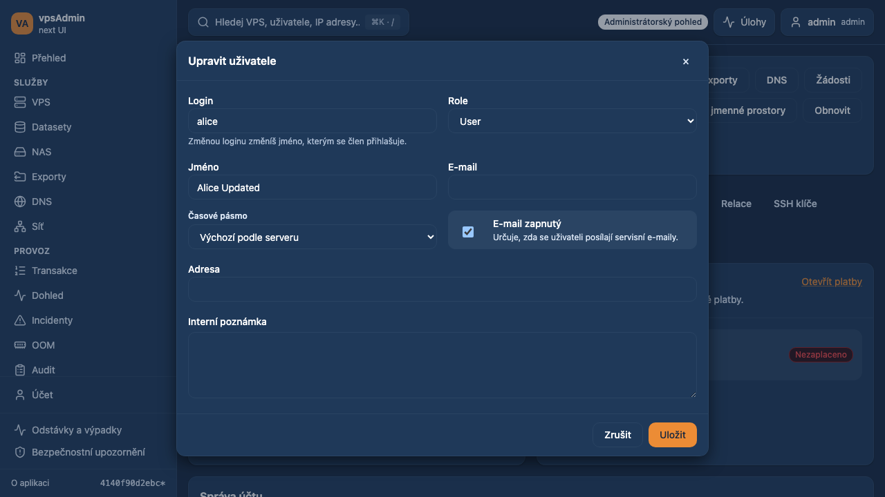
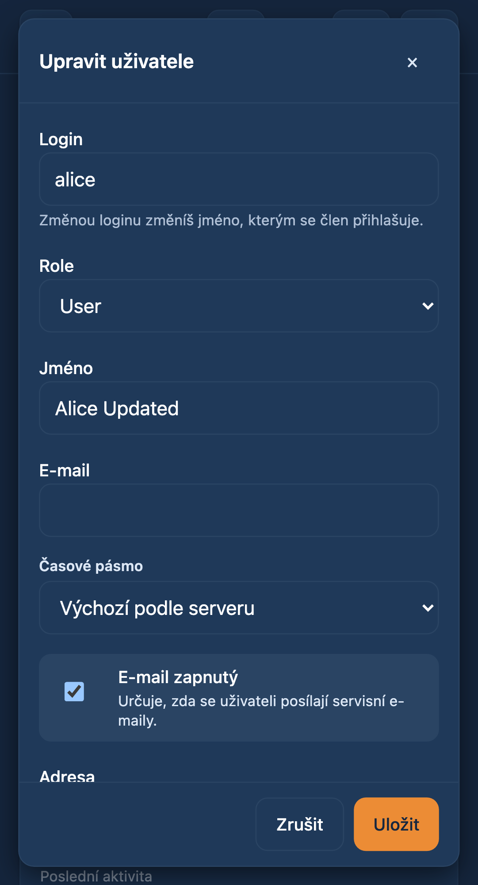

# Named roles in administrator member editing

Date: 2026-10-20. Requirement: REQ-040. Status: prepared for review; not merged
or deployed. Independent of the pending soft-delete expiration PR #81.

## Change and rationale

The maintainer requested the legacy named role selector instead of entering a
numeric level in the member details edit dialog. The new Role select offers
User (2), Power User (3), Admin (21), Super Admin (90), Master Admin (99).
Mapping was checked against the legacy `webui/config_cfg.php` and
`nixos/modules/vpsadmin/webui.nix`, and the API User model. Coarse frontend
role categories are deliberately not used for assigning exact privileges.

Existing unusual levels (for example 1 or 100) retain an explicit current-level
option. Saving another field preserves that value. Missing values show a
placeholder and fail validation instead of being coerced to zero. API policies,
mutation transport and error handling are unchanged. No API work is required.

The new component keeps the overview page smaller. Its reviewed structural-debt
allowance decreases from 787 to 784 lines, with an updated source hash; the
historical baseline is unchanged. The modified user-detail browser spec is
adopted into strict E2E TypeScript coverage without changing its error baseline.

## Localization and documentation

English/Czech labels are localized; privilege names match the legacy UI in both
languages. Locked vpsAdmin terminology revision:
`a65a4dfeb92a59df4a80a737a20bcbf8558793ff`. Both terminology and localization
guides were read from that Nix input on the build host (local Nix unavailable).
The KB contracts navigation/pages map legacy PHP pages, not this React admin
dialog. Reviewed read-only; no KB source or capture pin changes are required.
Workflow, requirement and action contracts are updated in this PR.

## Verification

- `npm run ci:quick`: passed, including strict E2E typing and documentation,
  catalog, structural and mutation audits.
- `npm run build`: passed; existing chunk-size warnings remain.
- Focused Playwright user detail suite: 26 passed on desktop Chromium and mobile
  Chrome. Named-role cases exercise every option and numeric payload, reopen
  after saving, and preserve an unusual existing level in English and Czech.
- `npm test -- --maxWorkers=2`: 300 files / 1,859 tests passed, including
  rejection of blank privilege values.

Local Node 24 fallback is used because this machine
has no Nix executable. Playwright uses synthetic API fixtures in English/Czech
on desktop Chromium and mobile Chrome; it does not certify live API permissions.
No real member role, dev server or production deployment is changed.

## Implemented UI (synthetic fixtures)

Desktop:

Mobile (scrollable modal body, fixed actions):

