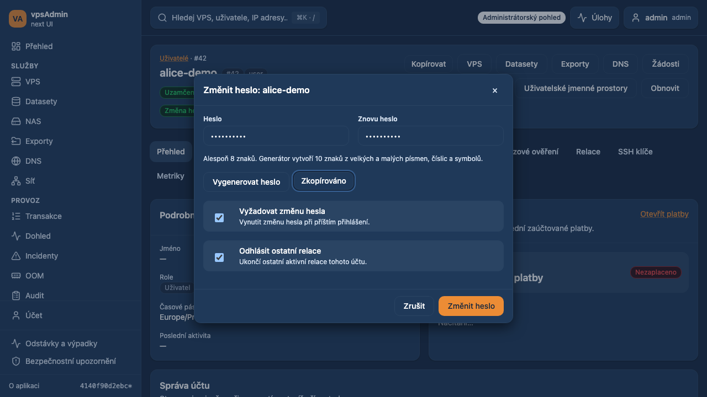

# Administrator password shortcut

Date: 2026-10-22. Requirement: REQ-040. Status: prepared for review;
not merged or deployed. Base: `4140f90d`.

## Behavior and API contract

The maintainer requested Change password immediately before Edit user in the
member Details header, with password/repeat, secure generation and copy. The
new dialog names the target account. It defaults Require password reset to true;
generating a new password checks that flag again. Log out other sessions also
defaults true. Both checkboxes can be changed explicitly.

One existing `updateUser` request sends `new_password`, `password_reset` and
`logout_sessions` for the selected user ID. The API User::Update source confirms
that a global administrator can replace another user's password without the old
password, closes sessions when requested, and applies the reset flag in the same
update. Minimum length is eight characters. No API changes are required.
The shortcut is hidden outside authenticated global-administrator/admin mode;
support remains subject to its existing API restrictions.

The existing cryptographic generator is reused with length 10. It guarantees
upper/lower-case letters, digits and symbols, draws from Web Crypto with rejection
sampling, and shuffles without modulo bias. Its global default length is unchanged.
A Web Crypto failure leaves manual entry available and never uses Math.random.

## Secret lifetime and concurrency

Fields are masked and marked `new-password`. Copy is explicit. Opening, cancelling
and successful saving clear the draft. Failure preserves the draft with a generic
localized error; raw server errors cannot reflect the password into the UI or
mutation cache. The secret snapshot uses a local ref, no persistent storage,
mutation variables or returned result. Automatic retries are disabled and mutation
cache retention is zero; the snapshot is released on settlement or unmount.
The clipboard is controlled by the explicit copy action.

The pending ref prevents duplicate submissions before React rerenders. Inputs,
close, generation and submit stay disabled until settlement. The action component
is keyed to member ID, so navigation discards its draft and an outstanding request
retains its original member. Successful completion refreshes that member's header
and identifies the affected login in the notification.

## Source and documentation review

Details header actions are extracted from the inherited large overview page.
Its reviewed structural allowance decreases from 787 to 783 lines, with a new
source hash; no historical baseline is relaxed. The new browser spec is adopted
into strict E2E typing. The script success cases use inventory-derived counts,
reusing the same correction as PR #82; exact compiler roots/import closure and
immutable deferred-source checks remain enforced.

Independent of pending PRs #81 and #82. Integration must preserve their lifecycle
and role changes and recalculate the shared overview source hash/line allowance.

English/Czech terminology guides were read from locked vpsAdmin revision
`a65a4dfeb92a59df4a80a737a20bcbf8558793ff` on the build host. UI translations
follow that guide and reuse existing security checkbox/copy labels. The separate
KB navigation bindings target legacy PHP member pages, not this React admin
shortcut; reviewed read-only, no KB pin/publication change is required.

## Verification

- `npm run ci:quick`: passed, including type checks, localization, structural,
  mutation, overlay and documentation audits.
- `npm run ci:tests`: 226 script tests, 57 BFF tests and all 300 unit files /
  1,859 tests passed.
- `npm run build`: passed; existing chunk-size warnings remain.
- New dialog Playwright suite: 16 passed across desktop Chromium/mobile Chrome.
  It verifies cs/en generation with every character group, exact copying and
  payload/owner binding, checked reset defaults, header refresh, manual overrides,
  short/mismatched validation, failure/retry without secret reflection, Crypto
  failure, cancel cleanup, support/My-view exclusions, duplicate suppression,
  and member navigation during a pending update.

Playwright fixtures use synthetic members and never change
real account passwords. Source/API contract inspection and local browser fixtures
do not certify live API authorization or the OAuth provider's forced-reset flow.
Local Nix is unavailable; checks use the repository's exact upstream Node
24.21.0/npm 11.19.0 toolchain downloaded from nodejs.org.

## Implemented UI with synthetic data

[Mobile dialog](assets/admin-user-password-20261022/mobile.png)
