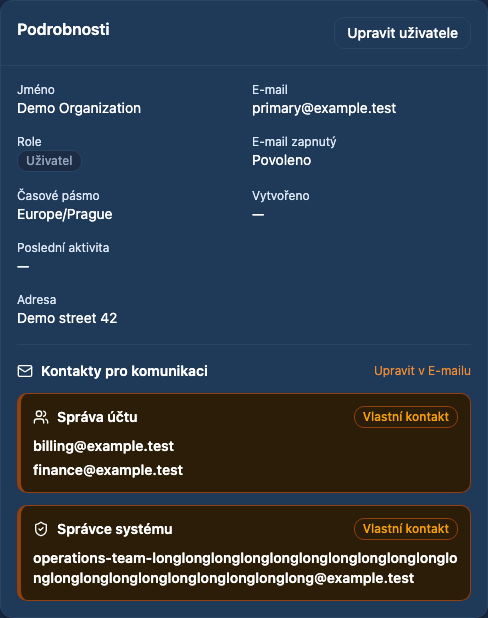

# Member communication contacts

Date: 2026-10-22. Requirement: REQ-053 (member context also REQ-040).
Status: prepared for review, not merged or deployed. Base: `4140f90d`.

## Requested behavior

The maintainer requested a prominent view of Account management and System
administrator contact settings beneath the address in administrator member details.
The legacy member page shows these mail-role recipients via `getUserEmails`.
They are contact roles, not the account's administrator privilege level.

The new summary reads the existing selected-user mail-role endpoint and uses
`computeEffectiveRoleTo`/`parseEmails` from the existing mail preferences model.
It identifies the two roles by stable IDs `account`/`admin`, independent of labels.
Explicit comma-separated recipients use amber cards, a left border, bold addresses
and a Custom contact badge. Empty/missing role recipients display the primary
email neutrally. If neither exists, the summary explicitly reports no contact.
It remains available when the member has no postal address. Mailer-disabled
accounts carry a separate delivery-disabled notice. These are role defaults;
individual mail template recipients retain their existing precedence.

Only global administrators in administrator view query/display this summary,
matching the API resource's cross-user read authorization and the legacy admin
contact section. Support still sees the postal address without the added read.
A failed read shows an explicit retry instead of falsely claiming fallback data.
The query key is shared with the existing Email tab, whose recipient updates
already invalidate it. The edit link retains the selected member ID. The summary
itself performs no product writes or API changes.

## Source and documentation

The address is extracted together with the new summary into
`AdminUserContactDetails`. The overview's reviewed structural allowance decreases
from 787 to 783 lines; the source hash is refreshed and the baseline is unchanged.
The new browser spec is adopted into strict E2E TypeScript coverage. The script
success assertions use the same inventory-derived count fix as PRs #82/#84;
compiler roots/import closure, initial roots and deferred baseline remain checked.

Independent of pending PRs #81/#82/#84. Preserve their changes and recalculate the
combined overview source hash/line allowance when integrating.

Terminology/localization guides already reviewed in this conversation at locked
vpsAdmin revision `a65a4dfeb92a59df4a80a737a20bcbf8558793ff` apply unchanged.
The separate KB bindings describe legacy PHP/member workflows, not this React
administrator summary; no KB source/pin/publication change is required.

## Verification

- `npm run ci:quick`: passed.
- `npm run ci:tests`: 226 script tests, 57 BFF tests and all 300 unit files /
  1,859 tests passed.
- Playwright: 18 passed on desktop Chromium and mobile Chrome. Cases cover cs/en,
  multiple/long explicit recipients, stable IDs despite different labels, primary
  fallback, no primary or role, no postal address, disabled delivery, read failure
  and retry, no product writes, scope exclusions and member navigation while the
  next contacts are loading.
- `npm run build`: passed; existing chunk-size warnings remain.

Checks use synthetic accounts/addresses and the exact Node 24.21.0/npm 11.19.0
fallback because local Nix is unavailable. No production member data was read or
changed. Fixtures and source inspection do not certify live API permissions.

## Implemented UI (synthetic accounts)

[Mobile summary](assets/member-contacts-20261022/mobile.png)
