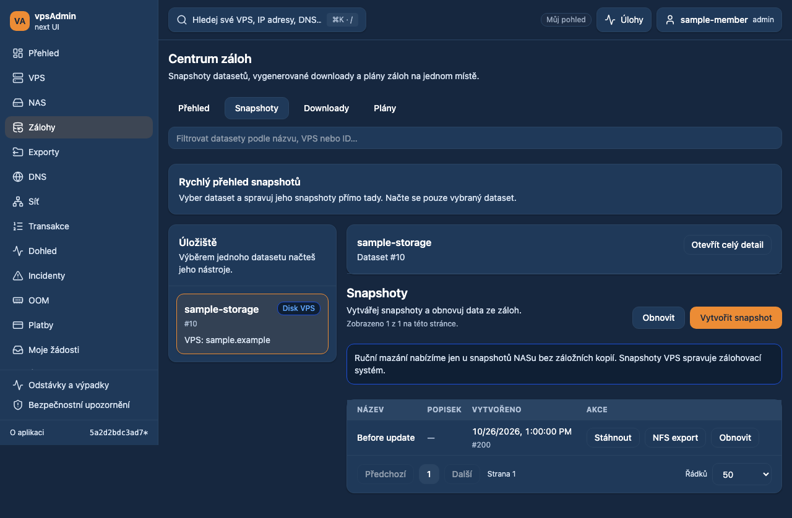
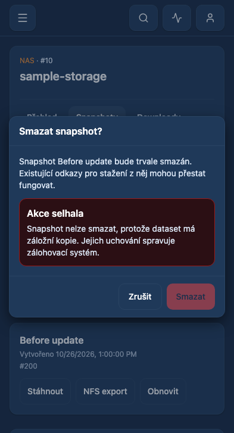

# Snapshot deletion availability and readable errors

Date: 2026-10-27. Requirement: REQ-048. Base: `5a2d2bdc`.
Status: prepared for review; not merged or deployed.

## API and legacy evidence

The maintainer relayed a failed snapshot DELETE with `cannot destroy snapshot
with backups` and asked to remove unavailable deletion actions. Legacy
`webui/forms/dataset.forms.php` omits Delete for VPS snapshot lists. Locked API
`Dataset::Snapshot::Delete` first rejects positive reference counts and then any
dataset placement on a pool with role `backup`, for administrators and members.
This is dataset-level backup membership, not whether the snapshot has a download.
The restriction is preserved; neither API logic nor backup retention is changed.

Dataset output has no reliable pool-role/deletion-capability field. The existing
Dataset#index supports roles `primary`, `hypervisor`, `backup`, a `dataset`
subtree and `to_depth=0`. The latter narrows both role probes to the exact dataset.
The old unused adapter `subtree` option incorrectly serialized as `subtree`;
it now uses the API's declared `dataset` parameter. `toDepth` and backup role are
added to that existing typed adapter. A test verifies exact parameter names and
that zero is preserved. Every result must refer to the requested dataset.

## UI behavior and safety

The shared mobile/desktop snapshot actions hide Delete for known VPS storage.
Otherwise, positive NAS primary-pool membership and absence of backup placement
are required. Pending, failed or mismatched evidence never enables deletion;
failed verification offers Retry. Known mount/export references also hide Delete.
A concise notice explains storage-level restrictions once above the list.
Download, restore, export, pagination and creation use their existing behavior.

An eligible snapshot still requires its named confirmation. The handler binds the
dataset ID, guards immediate duplicate submission and checks storage membership
again after the existing transaction preflight. If a backup appeared since the
list loaded, no DELETE is sent. Local lock acquisition/settlement and progress
identify the original target even when navigation changes during the request.
The backend remains authoritative for ownership, maintenance and references.

Both known backup and dependency errors are localized in Czech/English.
`formatErrorMessage` omits the user-unhelpful HaveApiError prefix for API errors
while preserving unknown server messages and other developer error class names.
The original error/envelope is unchanged for diagnostic details. A backup
rejection refetches availability; a dependency rejection suppresses that
snapshot's Delete action for this workspace. Reference counts beyond visible
mounts/exports are not exposed by the current API, so these cannot all be
predicted before the first backend check or after a full reload.

## Documentation and terminology

Localization procedures and terminology use locked vpsAdmin revision
`a65a4dfeb92a59df4a80a737a20bcbf8558793ff`; the snapshot restriction was also
confirmed directly in that source on dev. The external KB workflow and bindings
were reviewed earlier in this conversation: they target the legacy PHP source,
which is unchanged. No KB pin or publication is claimed. Requirements, workflow
and adapter inventory are maintained with this change.

## Verification

- `npm run ci:quick`: passed, including strict E2E coverage (74 adopted
  specifications), structural/mutation/localization/documentation checks.
- `npm run ci:tests`: 226 script tests, 57 BFF tests and 1,879 unit tests in
  303 files passed. The changed error/API/page helpers also passed 29 focused
  unit checks after the selected-language correction.
- Production build passed with the existing chunk-size warning. Frontend
  `npm audit --omit=dev` reports zero vulnerabilities. The independent,
  pre-existing BFF body-parser advisory is outside this feature; no broader
  release security certification is claimed.
- New deletion availability suite: all 42 checks passed across Chromium,
  mobile Chrome and mobile WebKit, cs/en and member/admin identities. It covers
  VPS detail and Backup Center exclusions, NAS success/cancel, exact DELETE,
  visible mount/export dependencies, backup membership, failed/mismatched read,
  Retry, fresh preflight, final API rejection, selected-language errors and
  suppression of repeatedly rejected actions.
- All 18 Backup Center regression checks passed on desktop/mobile Chrome.
- All 16 existing snapshot confirmation/rollback/download checks passed on
  desktop/mobile Chrome, including ambiguous rollback and manual unlock.
- Six NFS snapshot-export checks and four keyset-pagination checks passed.
- Final confirmation/capture pass: 22/22 (the 16 existing checks plus six cs/admin
  desktop/mobile/WebKit cases). This overlaps the counts above; the combined
  distinct browser coverage is 86 checks, not their repeated-run sum.

Earlier runs were not green: they caught a real English error in a Czech dialog,
now fixed by passing the active UI translator; an inherited test expecting Delete
on a VPS was updated to require its absence. New fixture request-URL typing and
an incorrect administrator Backup Center route were corrected. A WebKit-sensitive
exact read count was replaced with proof that preflight adds a fresh check. One
intermediate run was stopped after strict typing caught an omitted test variable.
Final passing evidence above supersedes those attempts, without relabeling them.
The two modified existing browser specs were adopted into strict typing; their
synthetic click guards now explicitly narrow to HTMLElement.

Browser fixtures are synthetic and do not certify live API deletion. No real
snapshots or backups were deleted. Local Nix is unavailable; checks use the pinned
Node 24.21.0/npm 11.19.0 toolchain. No API/server/database/deployment edits occurred.

## Review and implemented UI

Branch: `dev/snapshot-delete-guards`, separate from other prepared features.
GitHub CLI still returns HTTP 401; no actual PR or remote CI can be claimed.
Prepared review text and the scoped branch are available for maintainer review.
Nothing is merged or deployed.

Screenshots use synthetic accounts and data only:

[Mobile VPS actions](screenshots/2026-10-27-snapshot-delete/mobile-vps-snapshots.png)

[Desktop NAS deletion review](screenshots/2026-10-27-snapshot-delete/desktop-nas-delete-review.png)

[Mobile Safari review](screenshots/2026-10-27-snapshot-delete/mobile-safari-nas-delete-review.png)

