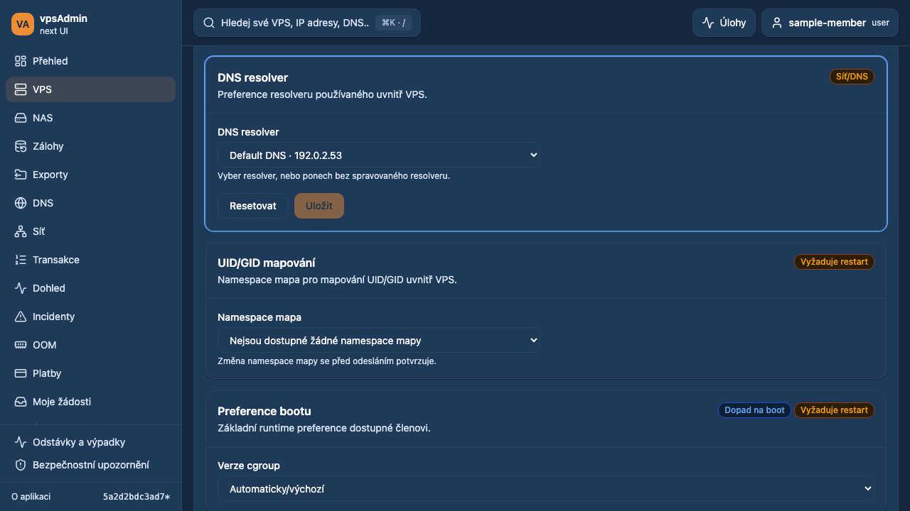
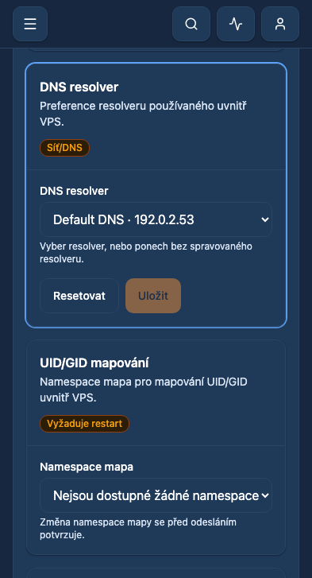

# Visible VPS DNS settings

Date: 2026-10-27. Requirement: REQ-050. Status: prepared for review;
not merged or deployed. Base: `5a2d2bdc`.

## Behavior

The existing DNS resolver setting was hidden under More → Configuration →
Additional VPS configuration. The maintainer requested a visible header-menu
entry. DNS servers is now the first daily action in both member and administrator
views. It opens `/config?section=dns`, preserves administrator member context,
expands the existing form and scrolls/focuses the resolver section. Selecting
it again on the same URL reopens a manually collapsed section without stealing
focus on background query updates.

Nearby Reset and Save use the same whole-form draft, review, validation and
mutation as the existing configuration header. Existing unsaved changes survive
the shortcut and appear alongside DNS in confirmation. No update is sent before
explicit confirmation. Reset retains the existing whole-form reset behavior.
Support can navigate to read-only DNS settings; this grants no new write access.
Role, object-state, lock and pending guards, action-state tracking and API payloads
are unchanged. The shortcut configures the VPS resolver, not zone management.

Additional configuration is extracted into a focused component without changing
its other controls. The parent drops below the 500-line structural limit, so its
obsolete reviewed exception is removed without changing the historical baseline.
The new Playwright specification is included in strict E2E typing and mobile
WebKit coverage.

English/Czech terminology guides were read from locked vpsAdmin revision
`a65a4dfeb92a59df4a80a737a20bcbf8558793ff`. The menu uses the requested friendly
DNS servers wording while the existing resolver field terminology stays intact.
The canonical KB workflow and current `vpsfree-kb-contracts` navigation/capture
bindings were reviewed read-only. They pin the legacy vpsAdmin source and PHP
navigation (`webui/`), including authoritative DNS pages, rather than this React
resolver shortcut. Those controls, source revision and captures are unchanged;
no legacy pin update or KB publication was performed. This does not certify that
external KB pages already document the React shortcut. No API, route registration,
dependency or server change is required.

## Verification

- `npm run ci:quick`: passed, including structural, localization, mutation,
  documentation and strict E2E type checks (72 adopted specifications).
- `npm run ci:tests`: 226 script tests, 57 BFF tests and 1,869 unit tests
  in 301 files passed.
- `npm run build`: passed with the existing chunk-size warning.
- `npm audit --omit=dev` in the frontend: zero vulnerabilities. The unchanged
  BFF has the already identified body-parser advisory; its independent patch
  remains outside this feature. This is not release security certification.
- New DNS Playwright suite: 18/18 passed across desktop Chromium, mobile Chrome
  and mobile WebKit, both languages and member/admin views. It checks the first
  daily menu option, target context, scroll/focus, opening without writes,
  confirmation before the exact resolver-only payload, persistence after reload,
  repeated same-URL reopening, preserved other drafts and read-only support.
  The final formatted-source run also passed 18/18.
- Existing configuration/resource/navigation regressions: 36/36 passed across
  desktop Chromium and mobile Chrome, including failure/retry, missing task
  identification, root disk controls and role restrictions.

Evidence is from local synthetic browser fixtures, not a live dev API test or
deployment. Local checks use the exact Node 24.21.0/npm 11.19.0 toolchain;
local Nix is unavailable. No API writes, deployments or service changes were
performed on dev or production.

## Review handoff

Branch: `dev/vps-dns-shortcut`, based on current main. GitHub CLI authentication
still returns HTTP 401, so an actual PR and remote CI cannot be claimed. The
scoped branch and review description are prepared; nothing is merged or deployed.

## Implemented UI with synthetic data

The desktop and mobile captures show the resolver section after using the menu.
They contain only a synthetic account, VPS and TEST-NET resolver addresses.

[Mobile Safari](screenshots/2026-10-27-vps-dns-shortcut/mobile-safari.png)

