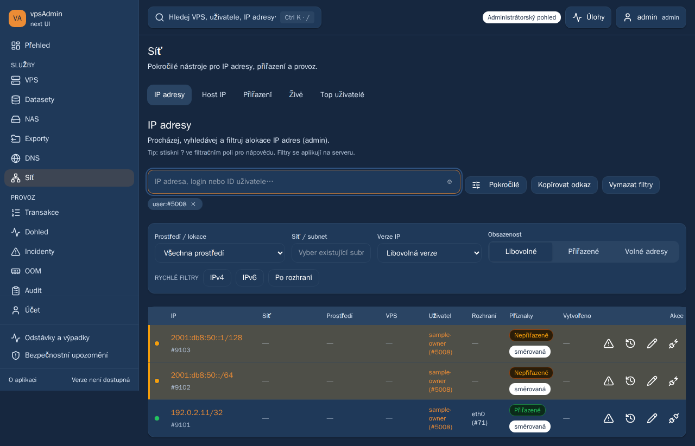

# Admin IP search by member ID — 2026-10-28

REQ-050/046/010. Prepared for review; no merge or deployment is authorized by
this new request. The previous release approval covered PR97–101 only.

The maintainer entered member ID 5008 into Network → IP addresses, but the
smart filter treated every bare number as an IP resource shortcut. Its sole
suggestion opened IP #5008 instead of querying the member's allocations.

A bare numeric input now sets the existing server-side `user` filter. The
first suggestion clearly describes owner IP addresses; the separate Open IP
suggestion remains available. `#5008` and `id:5008` retain deliberate IP-detail
navigation. Numeric q: inputs and legacy q URLs migrate to the same owner
filter without a numeric-login lookup or unsupported `q` API parameter.
Other manually selected filters remain in force. Cursor/local-page state resets,
copy/reload/back URLs retain owner scope, and default free-address suggestions
cannot hide assigned or historical-prefix addresses once an owner is selected.

No API changes or production member mutations. Existing administrator-only owner
filter enforcement remains; members/support do not gain global IP inventory
access. This is allocation ownership, not a claim about every IP attached to a
member's VPS when that allocation belongs to someone else.

Terminology reference: locked vpsadmin input
`a65a4dfeb92a59df4a80a737a20bcbf8558793ff`, resolved and both localization guides
read via Nix on the development machine. The deployed site's older API pin
`4a21dd25b23de9832166def98526f410416b651e` is unchanged; its existing `user`
index filter is reused. Czech/English placeholder, suggestions and help match.
The external KB workflow and networking bindings were reviewed: the navigation
contract binds legacy PHP sources (`webui/pages/page_networking.php`), unchanged
here. The optional Clankerdev capture variant still uses its historical source
pin; it was not repinned or certified by these React fixtures. External KB
captures/publication remain separate; no current KB verification is claimed.

## Verification

ci:pr passed: all quick audits/types, 226 script tests, 57 BFF tests, 1,906 unit
tests in 306 files and the production build. Seven added focused hook checks
cover numeric/explicit input, primary suggestion, filter/cursor preservation
and absence of a numeric-login lookup. Existing non-admin owner-filter blocking
and query-scope tests remain green.

On the development machine, the regression fails on the current deployed dev
bundle in desktop Chromium and mobile WebKit: the expected owner suggestion
is missing. An initial attempt lacked the browser-only fake standalone session
and reached Sign in required, so that attempt is retained as harness setup
failure, not evidence of this product defect. The corrected served-bundle harness
intercepts session/config and synthetic API requests; no real login/write is used.

The candidate ran on an isolated loopback Vite port on the development machine,
with artifacts outside the watched checkout: **38 passed, 2 intentionally
skipped, zero retries**. The skips are the existing desktop-table pagination
case in each mobile project. The complete IP filter/pagination and environment
specifications cover old behavior plus both locales, bare ID Enter, first-tap
suggestion selection, assigned/detached IPv4/IPv6 and historical prefixes,
reload/legacy numeric q URLs, explicit #ID/id:ID, unknown/failed logins, stale
lookup cancellation, filters and local/server pagination. The existing dev and
production services were not activated or changed.

Browser data and captures are synthetic. They establish request parameters/UI
behavior, not live authorization across actual member accounts. Traces/logs are
outside the repository under `/data/webui-browser-runner/evidence/ip-search-owner-20261028`;
local summaries are `/tmp/webui-ip-search-{ci,before-authenticated,candidate}.log`.

[Candidate mobile WebKit owner results](assets/ip-search-owner-20261028/mobile.png)

GitHub CI and PR outcomes follow after publication; this commit is prepared for
review and is not a merge/deployment record.
