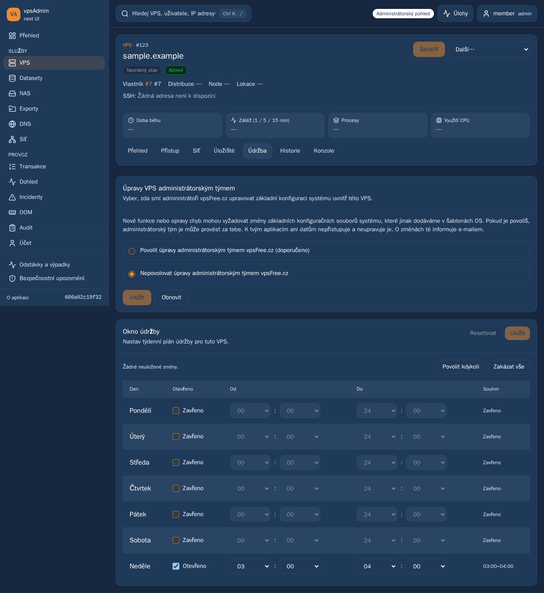

# Reviewed Tasks, Transactions and mobile release — 2026-10-28

Status: merged, deployed and verified on all three sites; configuration pin published.
The maintainer confirms the mobile preview works and requests merging our PRs
and deploying everywhere. Selected scope is PR97, PR98, PR99 and the subsequently requested PR101. Aither
PR74 and ETNyx PR63 remain excluded and untouched. No API, OS, database,
credential, infrastructure-policy or unrelated input update is authorized.
Requirements: REQ-010, REQ-012, REQ-023, REQ-051, REQ-063 and REQ-068.

| PR | Exact selected head | Behavior |
| --- | --- | --- |
| 97 | f43054125a9499e28bf3858a67325ee6d5acd217 | Compact Tasks history/inspection, no Tasks pinning, progress percentages. |
| 98 | 7dc259c79a0ba82188718b8b5d85fae164147369 | Member/admin columns, compact item rows/expansion, failure and pin tints, stable pin height and percentages. |
| 99 | 8cbb35952255068f59e45a4a57ee1d7197c96da5 | Lookup choices remain within clipping panels and viewport, preserving first-touch selection. |
| 101 | 548af8d6335ee1000cb9ac3dcb687e51601f906c | Accept an isolated synchronous admin preference, verify read-back and retain independent Sunday writes and other receipt guards. |

PR97/98/99 exact heads have six successful required CI checks. PR101 and the
updated combined integration require their own current-head checks. Main before preparation
is `9113caa0915b2908373ecd616f8f752e779ed4c9`. The integration branch retains
all selected original commits/authors and their dev-preview documentation.
Its initial application tree matched the maintainer-tested clean dev
`91ac3f64cb92`; PR101 adds the narrowly scoped acknowledgement correction
requested after the maintenance-page production report.
Before promotion, production was rechecked at `2d361c571eac`; dev was
`91ac3f64cb92`. The completed activation outcome is recorded below.

The dev receipt records combined ci:pr, 105 deployed fixture browser checks,
36 cold-menu/held-chunk checks and real anonymous runtime/auth checks, executed
on the development machine after the maintainer's preference was supplied.
The intermittent physical Safari menu symptom was not reproduced in fixtures;
the maintainer now reports it works on dev. Neither observation is an API
permission audit or universal physical-device certification.

Create one integration review to avoid sequential partial releases. Recheck its
exact head, main, selected heads and required CI before merge. Retain the tested
Git tree if the merge SHA differs. Build one exact clean paired release and
activate it on dev, clankerdev and newadmin with paired rollback. For newadmin,
use confctl and one generated WebUI input commit, preserving the deployed OS/API
pins. Publish only that pin patch on current configuration master; no deployment
receipts, screenshots or generated reports belong in that repository.

Repeat served-bundle synthetic feature acceptance and anonymous provenance,
config/auth, desktop/mobile and asset checks on all sites from the isolated
Linux browser runner. Preserve live sessions, secrets, configuration and other
services. Record actual CI, merge, package, runtime and publication outcomes
below after they occur, with fixture versus live limits explicit.

## Maintenance report added before activation

The maintainer explicitly requests fixing, merging and deploying the maintenance
report before this release. The API permits immediate DB-only saves for the
isolated admin-team preference; requiring a task produced a false missing-receipt
error and an uncertainty lock. PR101 preserves strict async/malformed-receipt
handling and verifies the exact submitted VPS boolean before confirming success.
Sunday-only requests are independently tested. Real production access remains
read-only and confirms Sunday is currently 02:00–05:00 on the reported VPS.

The earlier `be977e81` candidate passed all six CI checks and was built/staged,
including a successful newadmin dry activation, but was never activated or
published as a configuration pin. Its drafts are superseded by this combined
candidate. Only the final input-only configuration commit will be published.
The favicon request was explicitly cancelled and no favicon change is included.

## Merge and final candidate verification

All six checks passed at each of the five selected exact heads (30 total).
[Integration CI](https://github.com/vpsfreecz/vpsadmin-webui/actions/runs/40626455381)
and [integration browser CI](https://github.com/vpsfreecz/vpsadmin-webui/actions/runs/40626455464)
passed at `606a02c19f328c69298dd30780c805211fb5cb27`.
The [PR101 CI](https://github.com/vpsfreecz/vpsadmin-webui/actions/runs/40626338129)
and [browser CI](https://github.com/vpsfreecz/vpsadmin-webui/actions/runs/40626338162)
also passed at its exact selected head.

PR100 merged as `7f130a66108a3789494752da7cc693519e532dbb`; its tree
`1c90be74291b1511dde9ad99d9ac334d3540ec86` equals the tested candidate's tree.
GitHub also marked PR97, PR98, PR99 and PR101 merged by retained ancestry.
Runtime provenance intentionally identifies clean `606a02c19f32`, not the
GitHub merge wrapper or subsequent documentation-only commits.

Combined ci:pr passed 226 script, 57 BFF and 1,899 unit tests plus production
build. The focused 51-case candidate browser suite passed with zero retries
on the isolated development-machine runner. Before the fix, the new synchronous
regression failed as expected in both mobile engines on the old deployed dev
bundle. An exploratory candidate run had import/HMR and Loading-only failures
while writing artifacts inside the Vite-watched checkout; traces were retained,
outputs moved outside it and the whole scoped suite passed without assertion
changes. These failures are not reported as successful runs.

Separate Nix frontend/BFF, source contents, package contents, provenance and
module-evaluation checks passed. Newadmin's exact generated system built and
passed dry activation; its site packages matched all 373 frontend assets and
clean source metadata before activation. Other flake nodes and deployed
OS/API pins were checked unchanged.

The captures below show the implemented `606a02c19f32` bundle served by dev.
Only the session/API responses are synthetic, with fictitious account/VPS data;
no real production consent or maintenance window was changed for testing.

[Mobile WebKit capture](assets/admin-preference-sync-20261028/mobile.png)

## Three-site activation

The dev canary passed 105 served-bundle feature cases and 18 mobile navigation
cases before production promotion. Clankerdev then passed the same 123 cases.
Both runs used two workers, zero retries and the development-machine runner.
All three now report the clean runtime revision
`606a02c19f328c69298dd30780c805211fb5cb27` in paired frontend/BFF metadata.
Runtime inspection checks actual legacy BFF working directories and newadmin's
process command line against the expected package, not just symlink names.

| Site | Frontend and paired BFF location |
| --- | --- |
| dev.crucio.cz | `/data/webui-release-20261028/final/releases/606a02c19f328c69298dd30780c805211fb5cb27/{dist,bff}` |
| clankerdev.vpsfree.cz | `/opt/webui-next/releases/webui-606a02c19f328c69298dd30780c805211fb5cb27/vpsadmin/webui-next/{dist,bff}` |
| newadmin.vpsfree.cz | Frontend `/nix/store/bmvy1ghl0a3h1sd3fpszsvqsglgqng0m-vpsadmin-webui-frontend-1.0.0`; BFF `/nix/store/n2sycwv3kqxyprbnscbg1w4pgrk8mwd4-vpsadmin-webui-bff-0.1.0`. |

Newadmin used confctl generation `2026-10-28--04-30-24`, with dry activation
first and automatic rollback enabled. All seven health checks passed. Current
system: `/nix/store/9zk8ahwk4ml5bfjm74qwbjmmq4qxzzn5-nixos-system-vpsadmin-webui1-26.05.20261019.f3a73bc`.
Effective retained pins are nixpkgs `f3a73bcf5d1c5b75a66cf35a48957e30d41d647a`,
vpsAdminOS `f4bac6b493a507fb80b0935e703ac6568095b236` and site API
`4a21dd25b23de9832166def98526f410416b651e`. No API or OS upgrade was performed.

Legacy promotion validated runtime configuration/session-store access before
switching frontend/BFF pairs under deployment locks. Other dev BFF services
remain active. Live configuration, credential files and session stores were
preserved; retired inline secret environment keys are absent. The running
service retains its existing credential mechanism. Dev still uses its own test
API, while the public sites use `https://api.vpsfree.cz`.

Rollback retains dev's previous clean `91ac3f64cb92` pair and clankerdev's
previous `2d361c571eac` pair. Newadmin retains the previous system
`/nix/store/2vnpn1f65a58pgrmrmxr3dwnw785v9x3-nixos-system-vpsadmin-webui1-26.05.20261019.f3a73bc`.
Use the operations guide's paired rollback procedure and recheck live state;
do not restore session files or treat this application rollback as an API change.
No rollback was needed during this activation.

Builder root free space was checked at approximately 2.8 GiB, with build and
browser data under `/data` (approximately 842 GiB free). No global GC, unrelated
data removal, VM/disk deletion or other service upgrade was performed.
The old unused candidate pins and stages were never published or activated.

## Final acceptance and published pin

All three origins passed the same served-bundle browser acceptance:
105 core cases plus 18 navigation/held-chunk cases per origin, **369 passed**
in total with **zero retries**. Chromium desktop, mobile Chromium and mobile
WebKit cover the feature suite; both mobile engines cover navigation after a
cold login and delayed route chunks. The browser-only session/API fixtures
exercise permission gates, synchronous and asynchronous preference success,
malformed receipts, failed/unconfirmed reads, independent Sunday saves/reload,
Tasks/transaction presentation and bounded lookup selection. They do not write
to real member VPS or certify live API authorization between actual accounts.

Separately, nine real anonymous browser contexts (three per origin) verified
clean runtime provenance, API-origin separation, About/deep routes, first-tap
public menu/language changes, anonymous admin rejection, assets/MIME and no
uncaught JS exceptions or viewport overflow. All three real auth endpoint smoke
checks passed. Newadmin's CSP retains its existing console/heatmap frame and
payment-QR image sources. Only the existing dev TLS exception was used; public
TLS validation remained enabled. The cancelled favicon request was excluded.

Publication is one generated configuration commit,
[`2cf292f465ce`](https://github.com/vpsfreecz/vpsfree-cz-configuration/commit/2cf292f465cee8b969d53f8c96f937b021ecb4a6),
fast-forwarded from current master `38f573b49000`. Only `flake.lock` changed,
and its only changed node is `vpsadminWebui` (`2d361c571eac` to `606a02c19f32`).
The deployed system was built against the retained live configuration basis;
publication preserves the other contributors' current master inputs. No config
receipts, test reports or screenshots were added. The first push outside the
Nix tools shell failed because its Ruby hook interpreter was unavailable; it
was rerun from `nix develop` without bypassing hooks and published successfully.

Local command logs are `/tmp/webui-release-final-*-{public,auth,core,navigation}.log`,
with per-site `-verified.json` markers and `/tmp/webui-release-final-runtime-proof.json`.
Development-machine browser evidence is under
`/data/webui-browser-runner/evidence/20261028-final-release/`; private paired
activation receipts are outside all repositories. The package check, exact-head
CI evidence and activation logs remain separate from synthetic browser data.

Existing persisted uncertainty markers are intentionally not erased by this
release. After refreshing the page, an affected operator should inspect the
original result via **Open Tasks**, return to the warning and use **I verified
the result — unlock**. Reconciliation still refuses a busy or unverifiable VPS;
there is no blind retry or automatic production replay. Read-only inspection
before the fix found the reported Sunday's saved interval already at 02:00–05:00.

PR63 and PR74 were left open at their original heads. No new work from other
contributors was merged, deployed or rewritten. These results establish the
specified release behavior, not universal physical-iPhone certification or a
complete live API security audit.

Post-merge main also passed all three workflows at `7f130a66108a`:
[required checks/build/scripts](https://github.com/vpsfreecz/vpsadmin-webui/actions/runs/40628989442),
[complete PR smoke including both mobile engines](https://github.com/vpsfreecz/vpsadmin-webui/actions/runs/40628989484)
and [broad smoke](https://github.com/vpsfreecz/vpsadmin-webui/actions/runs/40628989485).
This completion receipt and captures are documentation only; the deployed runtime
remains the tested clean `606a02c19f32` pair and needs no additional pin update.
