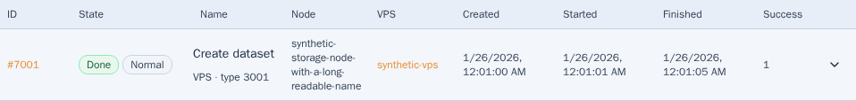
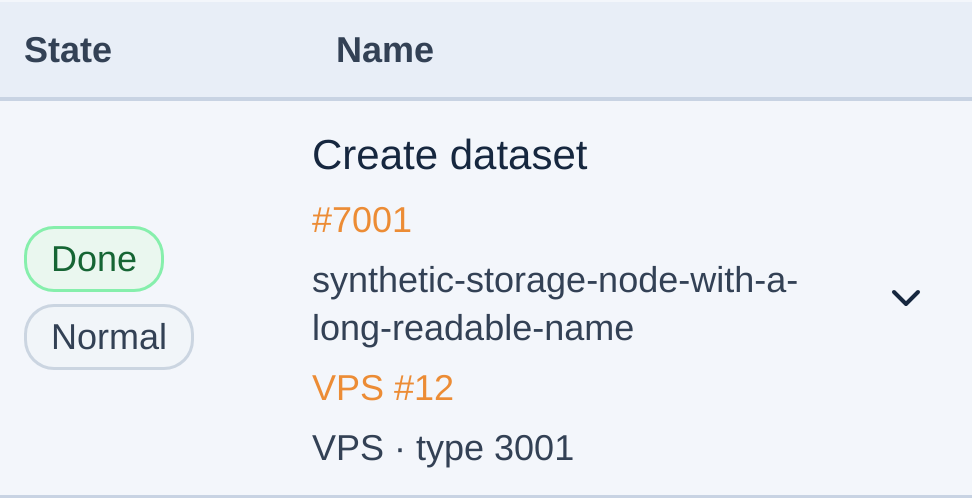

# Reviewed audit fixes: dev-only preview — 29 October 2026

Status: deployed and verified on dev only. Clean paired runtime revision:
`1c12a219ba87facd64fe27a8d135f14dbe7c6c36`. Later documentation commits do
not change this runtime pin. Main, production and original PRs remain unmerged.
The maintainer requested deploying the reviewed changes to dev.crucio.cz.
This authorizes the selected dev preview, not merging main, production promotion,
API changes or shared infrastructure repairs.

## Selected source and scope

Base main: `40653dffed4561dd6086716fd506a7223d3631d7`.
Observed previous paired dev runtime: `606a02c19f328c69298dd30780c805211fb5cb27`.
Recheck both deployment pointers, BFF process, lock and configuration immediately
before activation. No other deployment may be overwritten.

| PR | Selected original head | Change |
| --- | --- | --- |
| 102 | 3af0ae9b17904a96f7f3139deeb40fa7cfa93274 | Numeric admin IP search means member ownership. |
| 104 | 51c1fb6c59696916ef974c35e03b4ba0ab94aa71 | OAuth provider redirect and local navigation boundaries. |
| 105 | b723721725aef9fcb0e053490cad95b872548d94 | Compatible development dependency security patches. |
| 106 | 135e2031f00d89cd7d524bf3af5ecd2f29d80d4f | Private, redacted live-audit artifacts. |
| 107 | dea423a3817c2752d77e3d74ccf373669058171a | Consolidated VPS network toggle confirmations. |
| 108 | 698fd549c29fc60b8691945d2e28d50406b45461 | Singular metadata proxy security headers. |
| 109 | 2895f24f024011a29feeb55077f5b269ca4f4f0f | Bounded account menu and Escape/focus behavior. |
| 110 | 39ee1e6259bcd0395fc13f1b36dd57bde3252ce4 | Responsive action-state transaction inspection. |
| 111 | a175c6a5e1513b871d0cd422abbe9573e53c61de | Audit report and explicit limits. |

All six required GitHub checks passed for each exact head before preparation.
The preview retains original histories, including PR110's PR109 dependency.
Concurrent work-log insertions preserve both entries. PR63/74 are excluded.
Requirements: REQ-007/010/011/012/040/046/050/059/064/065/068.

## Preparation and activation contract

Build exact clean paired frontend/BFF packages on the development machine in
isolated /data space, with locked dependencies and matching truthful provenance.
Run combined quality, unit/script/BFF and targeted desktop/mobile browser checks.
The earlier seven-fix combined audit did not include PR102; this preview must
verify its inclusion rather than reuse that receipt as proof of the whole tree.

Adapt only the three replaced metadata headers in the effective dev nginx
locations for config.json, config.js and session.json. Preserve current routing,
CSP, OAuth/provider settings, credentials, sessions and all unrelated vhosts;
do not regenerate effective configuration from historical templates. Validate
nginx and candidate BFF configuration with actual systemd credentials before
promotion. Stage immutable matching packages and retain previous hashed assets.

Activate under the existing dev deployment lock with expected-previous checks.
Retain the exact prior frontend/BFF pair and nginx bytes for rollback. Validate
service health, real metadata/origin guards and anonymous bootstrap separately
from browser-local synthetic session/API feature checks against the served
candidate. The browser harness must block direct versioned API writes.

## Explicit limits

No production or configuration-repository input update, main merge, API upgrade,
shared queue repair, test-account re-enablement or unrelated cleanup is included.
The audit's queued NAS fixtures and dev TLS/refresh/payment/passkey limits remain
as documented in the [audit report](../audits/webui-security-review-2026-10-28.md).
A deployed-bundle fixture test is not a new actual cross-member API audit.

## Completed verification

- All 54 required GitHub checks passed on the nine original selected heads;
  their SHAs were rechecked immediately before activation. Combined preview
  [PR112](https://github.com/vpsfreecz/vpsadmin-webui/pull/112) is a draft review
  receipt. Its automatically triggered broad browser CI was still running at
  activation; no pending job is reported as green. Local combined verification
  below passed on the exact clean runtime source.
- Fresh locked root/BFF installs and full/production/BFF dependency audits passed
  with zero known npm vulnerabilities. ci:quick, 230 script checks, 58 BFF checks,
  all 1,914 unit tests in 306 files (two workers), and production build passed.
- Exact clean x86_64-linux Nix frontend/BFF, provenance, source contents, package
  contents and module-evaluation builds passed. Frontend:
  `/nix/store/qcy313rkv9h7yy1dycbvp8fqdr9lnz7y-vpsadmin-webui-frontend-1.0.0`.
  BFF: `/nix/store/dyd7gfahs09yzyhkbckj5kfajvzm3zqp-vpsadmin-webui-bff-0.1.0`.
- The candidate package passed 64 browser checks, with two existing mobile skips,
  zero retries and no failures (66 selected). The same suite against the actual
  HTTPS-served dev bundle passed 64 checks, two skips, zero retries. Coverage:
  owner-IP search in cs/en, filters/page navigation, explicit IP IDs, rejected
  network changes/retry, header widths/focus, action-state detail/reload/cancel,
  responsive transaction columns, payload expansion and first-tap controls.
  Both sets ran on the development machine in desktop Chromium, mobile Chromium
  and mobile WebKit. Browser-local session/API fixtures blocked direct versioned
  API writes; these are not additional real cross-member authorization tests.
- Three separate unmocked anonymous browser contexts passed clean revision,
  dev API origin, About/commit link, public menu/language first taps, admin denial,
  asset MIME/status, JS-error and viewport checks. Auth endpoint smoke passed.
- Real wire checks confirm one Cache-Control, CORP and nosniff field on each of
  config.json, config.js and session.json. Anonymous session values are exactly
  three null fields. Cross-site session reads and GET logout return 403. Public
  config remains 200 with only its documented public fields and CORP same-origin.
- Seven unmocked mobile WebKit checks passed actual OAuth login and application
  bootstrap, authenticated BFF session, exact member identity, first-tap
  menu/Transactions/Tasks, authoritative logout and provider token revocation.
  Only the previously verified same-chat disposable fixture 29 was temporarily
  enabled. Original credentials/flags were restored, all its temporary access
  revoked and locked/zero-open-session state verified. No auth media, storage
  snapshots or token-bearing logs were created; the private credential backup
  was replaced with a redacted cleanup receipt.

## Activation, preservation and rollback

The dev-only activation ran under `/run/lock/clankerdev-dev-deploy.lock` after
expected-old-revision, live BFF cwd, package manifest, current-head and config
checks. Actual systemd credentials validated the candidate configuration and
session-store access. Both pointers now resolve to
`/data/webui-audit-preview-20261029/releases/1c12a219ba87facd64fe27a8d135f14dbe7c6c36/{dist,bff}`
through their existing host-specific path layouts. The running BFF cwd and both
metadata files match that full SHA, dirty:false. Existing hashed assets remain
available for open tabs.

Only nine proxy_hide_header lines were added to the effective dev site's three
metadata locations. The existing nginx includes, routes, CSP, OAuth/test API
routing, systemd unit, credentials and session store were preserved. nginx syntax
and BFF health passed. Only the authorized dev BFF was restarted; nginx reloaded
its validated configuration. API and the unrelated kra BFF retained their PIDs
and active state. No queued NAS or mailer operation was modified.

The exact prior paired runtime remains at
`/data/webui-release-20261028/final/releases/606a02c19f328c69298dd30780c805211fb5cb27`.
Private original nginx bytes, hashes and activation receipt remain below
`/data/webui-audit-preview-20261029/private`; the guarded rollback helper restores
both pointers and the matching proxy configuration without restoring session
files. No rollback was needed. Build, stage and browser work stayed under /data;
root has about 1.8 GiB free and /data about 836 GiB. No global GC or unrelated deletion.
The own loopback candidate server and its temporary TLS key were removed.

After acceptance, both production origins still report clean 606a02c19f32 and
shared main remains 40653dff. No configuration-repository pin was updated. Original
PR102/104–111 and colleague PR63/74 remain open and untouched.

## Retained setup corrections and evidence

The initial Nix attempt rejected a world-writable own temporary build parent;
changing only that parent to 0755 allowed the exact build. The isolated nginx
preflight initially lacked relative include references under its private prefix;
read-only references corrected the test setup before live changes.

The initial wire probe incorrectly expected 403 for public config and used POST
for the documented GET logout route. The first real login/menu/Tasks probe passed
but its incorrect POST logout returned 404; cleanup restored/locked the fixture
before the corrected seven-check repeat. These are retained test-driver failures,
not application regressions. No runtime guard or assertion was weakened to hide
an application defect; the probes were corrected against the existing BFF routes.

Evidence is under
`/data/webui-browser-runner/evidence/audit-dev-preview-20261029/`: source/status
logs, candidate/deployed browser results, wire-proof.json, public-probe-summary,
redacted live-auth proof/cleanup and retained-setup-observations.json. No private
credential value or authenticated personal data belongs in this repository.
The previously documented dev TLS exception remains; no TLS identity or new
positive payment/NFS/refresh/passkey certification is implied by this preview.

Review at <https://dev.crucio.cz/app/transactions> and
<https://dev.crucio.cz/admin/networking/ip-addresses>.
The implemented captures below are from the actually served dev bundle with
synthetic data only:

