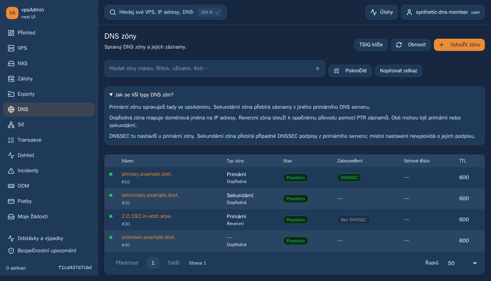
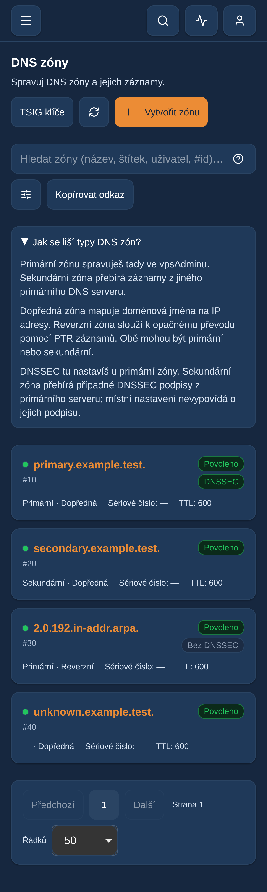

# Network and DNS dev preview — 30 October 2026

Status: deployed on dev only as clean paired runtime
`f1cd437d7cbdb4f88884793deefb10daecd29999`. Served acceptance passed;
completed evidence and explicit live limitations are recorded below. The maintainer requested
implementing the DNS feedback and deploying all this task's changes to dev.
No main merge, production/API deployment or configuration-repository pin update.

## Exact selected scope

Preserve dev preview PR112 at `455ea11f71a0783cd8ac1788e4ed1cc445c540c8`,
then merge only these original feature heads into a separate preview branch:

| PR | Head | Change |
| --- | --- | --- |
| [113](https://github.com/vpsfreecz/vpsadmin-webui/pull/113) | e90be4264cce5a4acec4cb68d299245a95f7e468 | Continue bounded primary-location free-IP samples. |
| [114](https://github.com/vpsfreecz/vpsadmin-webui/pull/114) | 6328f65be793cb483df797ac32efd375d9cc7c8a | VPS-first assignment and synchronous owner read-back. |
| [116](https://github.com/vpsfreecz/vpsadmin-webui/pull/116) | 94fb440c1a0086569af201637c1f647f6663f300 | Primary/secondary and direction labels, DNSSEC responsibility, wildcard owners. |

Original feature histories/reviews remain independent. PR63/74/115 and other
unrelated work are excluded. Concurrent documentation inserts preserve all
entries; REQ-049 and REQ-050 retain both sets of acceptance criteria, and both
IP suites plus the DNS suite remain in mobile WebKit's selection.

## Preparation and activation contract

Observed current paired dev runtime and rollback target:
`1c12a219ba87facd64fe27a8d135f14dbe7c6c36`. Production remains clean
`606a02c19f328c69298dd30780c805211fb5cb27`; main remains `40653dff`.
Recheck live pointers, process cwd, original PR heads, main and deployment lock
immediately before promotion. Build exact clean matching frontend/BFF Nix
packages and provenance/source/package/module checks on dev in isolated /data
space. Run combined checks and browser regressions on the development machine.

Retain the current nginx configuration, credentials, session store and systemd
unit byte-for-byte. Validate the candidate with the existing actual systemd
credentials before activation. Stage immutable packages, keep existing hashed
assets for open tabs and activate both pointers under the existing deployment
lock. Roll back the exact previous pair if acceptance fails. No global GC,
shared queue repair, unrelated service restart or deletion is included.

Separate served-bundle synthetic UI checks from unmocked public/OAuth/API checks.
Only same-chat disposable fixtures may be enabled; restore original access flags
and revoke temporary credentials after bounded actual tests. Synthetic UI proof
is not live DNS publication, cross-member authorization or infrastructure proof.

## Evidence and remaining work

Feature-specific evidence and limits are recorded in the three dated logs.
PR113/114 each passed six exact-head GitHub checks; PR116 CI is in progress at
preparation. Combined build, deployment, actual runtime SHA and final acceptance
will be appended after completion. No prepared status implies deployment.

## Completed build and feature verification

All six GitHub checks passed on each exact original PR113/114/116 head before
activation (18 checks). PR116 broad browser CI passed 629 desktop, 571 mobile
Chrome and 271 mobile WebKit checks, with two existing WebKit skips. The combined
preview is [draft PR117](https://github.com/vpsfreecz/vpsadmin-webui/pull/117);
its nonbrowser/build/script checks passed, while broad browser CI was still
running at activation. Pending jobs are not counted as passes.

Combined verification on the exact runtime source passed ci:quick, all 230
script checks, 58 BFF checks and 1,944 unit tests in 307 files (two workers),
production build and root/BFF npm audits with zero known vulnerabilities.
The first script-test run lacked rsync in the isolated container PATH; the full
230-check repeat passed with the pinned rsync path, without source or assertion
changes. Both logs are retained.

Exact clean Nix frontend/BFF plus provenance, source contents, package contents
and module evaluation passed. Packages:

- `/nix/store/ibnpl4xwzjbdr1hnl4ijr9pg30snb1s7-vpsadmin-webui-frontend-1.0.0`
- `/nix/store/vk73h8vhj2bhdn2j5y0g04nvk25vhgja-vpsadmin-webui-bff-0.1.0`

Both metadata files report the full runtime SHA and dirty:false. Own indirect
GC roots retain the packages/check outputs. The first staging helper mistakenly
read the prior build-results directory; expected-SHA validation stopped it before
creating or activating anything. Correcting only that helper path allowed staging.

The exact packaged candidate passed 115 desktop/mobile browser checks with two
existing mobile skips, no failures and zero retries (117 selected). Coverage:
cs/en DNS kinds/directions, unknown state, primary/secondary DNSSEC payloads and
direct URLs, bare wildcard create/edit, primary-location pagination and request
budgets, owner search, VPS-first assignment, stale/foreign ownership rejection,
read-back verification and durable uncertain-result guards. All browsers ran
on the development machine: desktop Chromium, mobile Chrome and mobile WebKit.
Synthetic requests block direct versioned API writes and prove UI behavior,
not actual cross-member authorization or DNS publication.

## Activation and unmocked acceptance

Promotion used the existing deployment lock and rechecked the exact old pair,
current feature heads/CI, main, candidate manifests and live process cwd.
Actual systemd credentials validated candidate configuration/session-store access
before activation. The frontend and BFF now resolve below
`/data/webui-network-dns-preview-20261030/releases/f1cd437d7cbdb4f88884793deefb10daecd29999`.
Running process cwd, both clean metadata files and BFF health match that revision.

nginx vhost/main configuration, systemd unit/drop-in, credential files and session
store were preserved. Existing hashed assets were carried forward for open tabs.
Only the dev BFF restarted and nginx reloaded its validated unchanged config;
API, supervisor and unrelated kra BFF retained their PIDs. Rollback retains the
exact previous 1c12a219 frontend/BFF pair. The guarded helper can restore that pair
without replacing configuration or session files. No rollback was needed.

Three unmocked anonymous browser contexts passed revision/dev API origin,
About/commit, first-tap menu/language, unauthenticated admin denial, asset MIME,
JS-error and viewport checks. Real wire checks passed singular metadata headers,
anonymous null session, cross-site session/logout denial and public-config scope.
No mocks were used for these bootstrap/wire checks. The existing dev TLS exception
is retained; this does not certify TLS identity.

## Actual DNS test and infrastructure limit

Unmocked mobile WebKit passed OAuth login as the exact same-chat disposable
member 29, first-tap menu/DNS navigation, secondary zone creation, a label update
without a DNSSEC field, direct secondary DNSSEC explanation and independent API
read-back. Primary creation was accepted and its ownership/source read back.

The subsequent wildcard action could not run: primary creation chain 406 is
queued at 0/3 on pre-existing DNS node 102, whose last report is 10 October and
whose status is offline. The zone remains properly locked. The browser timed out
waiting for its create-record control; no DNS record was posted. This is a live
infrastructure limit, not a passed wildcard/publication test. The fixture/unit
wildcard checks above passed; no publication/delegation claim is made.

Cleanup removed the own secondary zone 10. The own primary zone 11
`webui-preview-20261030-b.test.` remains pending; its API deletion was refused
while locked. Do not bypass the lock, rewrite transactions, force-delete database
rows or repair shared DNS services as part of this preview. After authorized DNS
node recovery, finish this own chain and remove only this exact owned test zone.
No existing zone, record, delegation or production DNS resource was modified.

Original member credentials/flags were restored, temporary access revoked and
locked/zero-open-session state verified in a finally cleanup. No browser traces,
media, storage state or token-bearing logs were created for the authenticated
probe. The private credential ledger was replaced by a redacted cleanup receipt.
A read-only diagnostic initially used an unavailable Node#up? method; using the
actual Node#status contract corrected the probe without writes.

Evidence is under
`/data/webui-browser-runner/evidence/network-dns-preview-20261030` and the guarded
activation/rollback receipt below the release's private directory. Own temporary
loopback server/TLS files were removed. Builds/test artifacts stayed under /data;
root has about 1.1 GiB free and /data about 836 GiB, with no global GC or unrelated
deletion. Both production origins still reported clean 606a02c19 before activation.

The implemented views below are from the actual served dev bundle using only
synthetic member/zone data; they are not authenticated production captures.

## Final served acceptance and preservation

The same 117 selected checks against the actual HTTPS-served dev bundle passed
115 tests, with two existing mobile skips, zero failures and zero retries (5.3m).
This repeats the candidate suite without starting a development server. Both
candidate and deployed results use synthetic browser-local API/session responses;
the actual OAuth/DNS probe above is separate and its primary limit remains open.

Post-acceptance checks confirmed matching live frontend/BFF provenance and cwd,
unchanged configuration hashes and unrelated service PIDs. Both production
origins remain clean 606a02c19f32 and main remains 40653dff. The same-chat fixture
is locked, OAuth disabled and has zero open sessions. No main/feature PR was
merged. Later documentation commits do not change the deployed runtime pin.

## Combined GitHub CI outcome and bounded follow-up

The original combined run passed 642 desktop assertions in 29.5 minutes, 584
mobile Chrome and 284 mobile WebKit checks (two existing WebKit skips). However,
the desktop job was cancelled immediately after its pass summary: its check
annotation confirms the maximum 30-minute job time. Keep that cancelled outcome;
it is not a green workflow despite all assertions passing.

Separate [PR118](https://github.com/vpsfreecz/vpsadmin-webui/pull/118) raises only
the overall PR browser job budget to 40 minutes. All 11 existing workflow/CLI/
harness contract checks passed with pinned Node 24.21.0. Matrix, two workers,
test selection, assertions, per-test bounds, retries and report retention stay
unchanged. The preview includes this CI-only follow-up for its next GitHub run;
that run is pending at handoff, not counted as a pass. This requires no application
redeployment: the tested served runtime remains clean f1cd437d7cbd. Original
PR113/114/116 remain individually green and unmerged. No production update.
