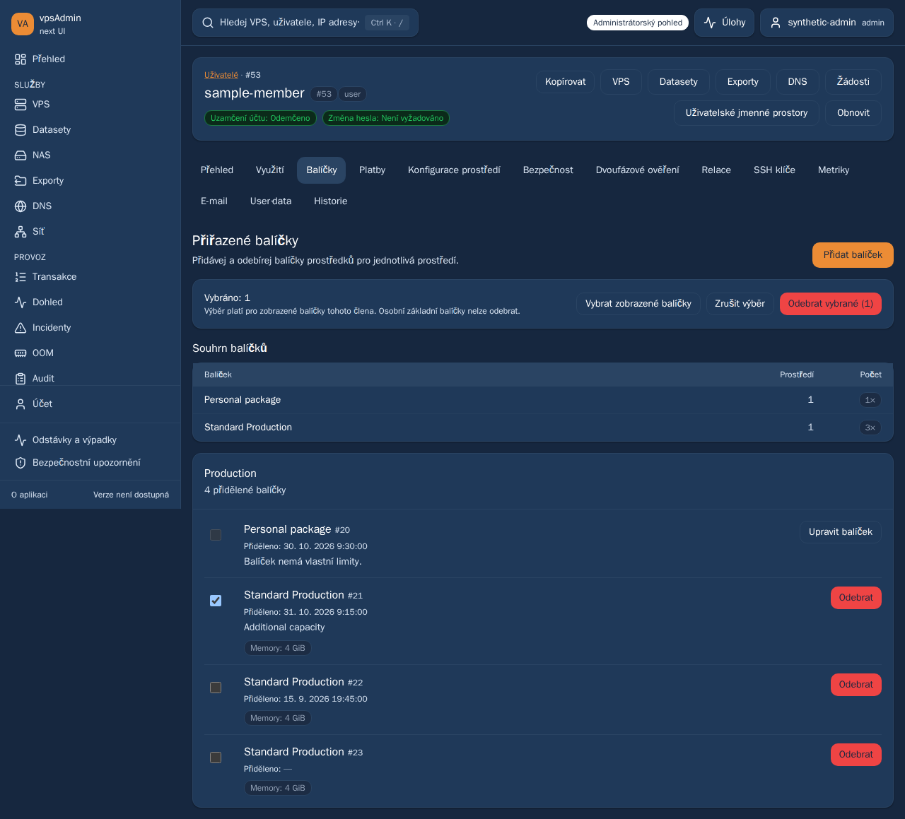
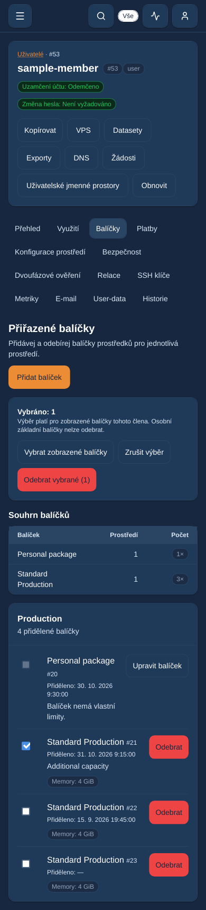

# Member package assignment timestamp — 31 October 2026

REQ-040, preserving REQ-076. The maintainer requests the assignment date in the
administrator member's Packages tab. Prepare a focused PR above current main
`40653dff`; do not merge, deploy or include pending unrelated reviews.

Show a compact Assigned/Přiděleno line under every individual assignment name,
including personal base packages. Use its existing `created_at` output and the
shared account-time-zone formatter, as used for member payment timestamps.
The signed-in operator's preference applies, not the selected member's or browser
zone. Preserve missing-date dash, raw machine-readable time and all existing
comments, resource badges, summary grouping and mutation/selection controls.

Source contract: HaveAPI UserClusterResourcePackage common/all Index/Show output
exposes created_at; the frontend adapter already includes that field. Creation
creates a separate assignment record; editing a comment updates that record.
Do not substitute ClusterResourcePackage.created_at or assignment.updated_at.
No adapter, endpoint, authorization, backend or database change is needed.

Terminology guide/procedure resolved from locked vpsAdmin revision
`a65a4dfeb92a59df4a80a737a20bcbf8558793ff`, confirmed against its Nix store path.
The first Nix lookup omitted experimental features; the explicit nix-command/
flakes retry resolved the unchanged locked input. Both cs/en contexts reviewed.
The canonical KB workflow and member resource-package bindings were inspected;
they currently bind legacy PHP navigation and independent historical React
captures. This admin-only metadata addition changes none of those control
fingerprints or API pins. Do not insert a WebUI revision into the API input or
claim regenerated external KB captures. Current React desktop/mobile synthetic
captures will accompany this PR; no wiki publication.

## Verification and status

Prepared for review, not merged or deployed. Browser tests cover cs/en, personal and duplicate
shared-package assignments, missing timestamps, distinct update/definition dates,
operator/member/browser time-zone differences, mobile width and unchanged safe
selection. Tests run on the development machine in the isolated pinned runner,
not on the Mac. Fixtures certify display behavior, not live API permissions.

Completed on the isolated development-machine runner with pinned Node 24.21.0:

- ci:quick passed (including application/E2E/BFF type checks and cs/en audits),
  production build passed, and all 13 existing formatter/account-zone unit
  checks passed.
- All 18 existing bulk-package browser checks passed. All six final assignment-
  date checks passed in cs/en on desktop Chromium, mobile Chrome and mobile
  WebKit, with zero retries or skips. No application code changed between them.
- The first strict E2E manifest check required alphabetic placement of the new
  path; both manifests were corrected and full ci:quick plus final strict E2E
  typing passed. Keep the original diagnostic log.
- The first new browser guard incorrectly treated the existing shell's UI-
  preference synchronization PUT as a package mutation. Retained traces identify
  exactly `/webui_user_settings/ui/settings`. The final guard permits only that
  established PUT and rejects all other unexpected writes; date/time/selection
  assertions are unchanged. This was a test-scope correction, not a UI failure.

Evidence is under
`/data/webui-browser-runner/evidence/member-package-assigned-date-20261031`.
Browser tests used Vite and synthetic API/session responses in an isolated
checkout on the development machine, not the currently served dev bundle.
No server deployment, API/database write or test-account provisioning was needed.
The running dev preview and all production services remain untouched.

Implemented synthetic views:

