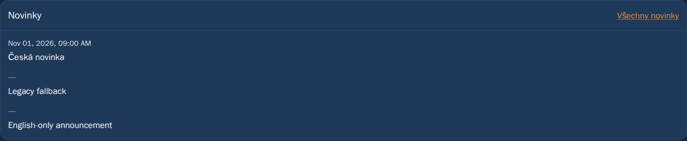
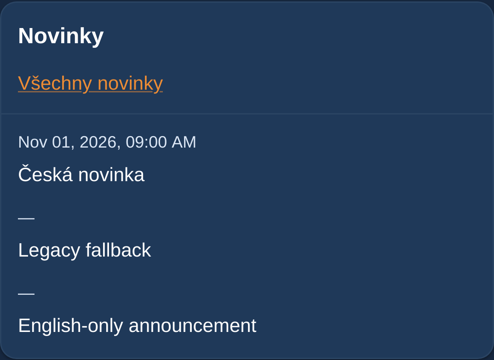

# Anonymous overview news follows UI language — 1 November 2026

Status: prepared and locally verified for review. REQ-054. No merge or deployment.
The browser's English locale correctly selects the initial UI language, but
the public overview renders news.message directly after a Czech UI override.
The news list and signed-in dashboard already use pickLocalizedFieldFrom.
Reuse that existing selection on the overview, preserving sanitized rendering,
English/legacy fallbacks, ordering, dates and error/empty states.

A read-only anonymous GET on the actual dev API confirms that each news row
exposes message, en_message and cs_message. Only field names were recorded;
no authentication or write was used. Both localized variants are already in
the response: no API/transport/header/cache-key change is required. Existing
global locale invalidation remains intact; cached text selection itself does
not depend on a new response.
Security advisories already select localized fields and remain unchanged.

Terminology was read from locked vpsadmin input
a65a4dfeb92a59df4a80a737a20bcbf8558793ff. No catalog wording is changed.
The external vpsadmin-kb-captures workflow was unavailable in this workspace;
external KB screenshots are not claimed current.

Verification plan: English system locale, anonymous dark mode, switch to Czech
and back without login on overview and news list, preserve missing
translations, reload the explicit override, assert no private settings request
and capture synthetic desktop/mobile evidence on the remote dev runner.

## Verification

On current dev runtime 70bd11d9, English-browser anonymous overview cases fail
in Chromium and mobile WebKit exactly because the Czech heading still wraps an
English news message. Both `/news` controls pass. The first probe also asserted
a single network request incorrectly: existing global locale invalidation
refetches queries, so the probe was corrected to preserve that existing contract.
The UI change does not add a forced request or alter global invalidation.

Fresh pinned Linux dependencies, ci:quick, all nine focused unit tests and the
production build pass. The patched served bundle passes all six anonymous
regressions across desktop Chromium/mobile Chromium/mobile WebKit with zero
retries: both routes, explicit cs/en over an English system locale, legacy and
missing-Czech fallbacks, reload persistence and no private-settings requests.
The initial staging nginx could not traverse the intentionally private runner
directory. Only public dist files were copied to an owned static staging root;
the runner permissions were not widened. Failed harness output is retained.

The images below capture implemented UI with synthetic announcements on remote
staging, not authenticated production data or a production deployment.

## Header alignment follow-up

The maintainer additionally requests that All news sits slightly lower, aligned
with the Novinky title. Align only the public news CardHeader on its first
baseline at the existing row breakpoint. The title and link have different font
sizes/line heights; top alignment placed the smaller action text too high.
Keep the shared CardHeader default, all other cards and 16px left padding intact;
small screens retain the existing stacked layout.

The geometry regression fails on the previous served bundle with a zero-pixel
vertical offset, reproducing the high action alignment. The updated production
bundle passes all six existing anonymous news checks with zero retries across
desktop Chromium, mobile Chromium and mobile WebKit on the remote dev runner.
The desktop assertion verifies a small positive action offset (0.5–4px) and
matching title/message left edges (within 1px). Mobile retains its stacked header
and no horizontal overflow. The captures above were replaced with these results.
The production build, strict E2E typecheck and design-document audit also pass.
Evidence is retained under the remote runner's
`evidence/public-news-20261101/alignment-{before,after,build,checks}` logs/output.
This update belongs to PR124; it does not merge or deploy that PR.

## Further public overview feedback

PR124 also includes the maintainer's follow-up to remove redundant subtitles,
unify card padding and explain heatmap reading. The news captures above were
refreshed from the same implementation. See
[scope, visual evidence and verification](2026-11-01-public-overview-readability.md).
