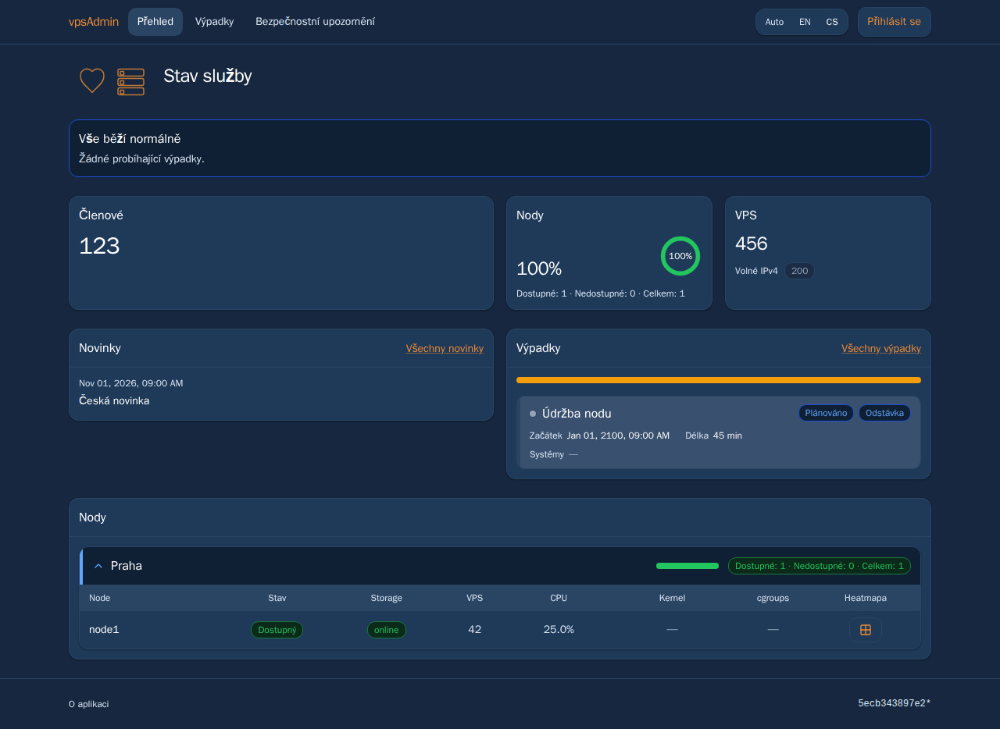
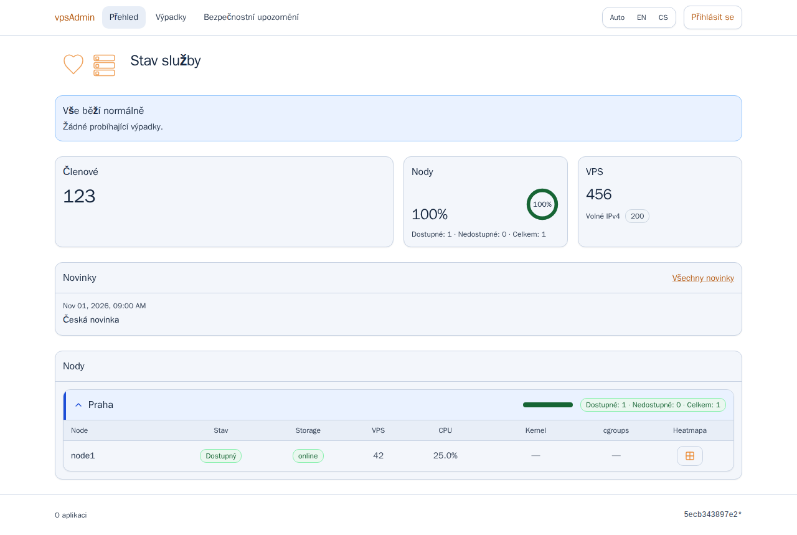
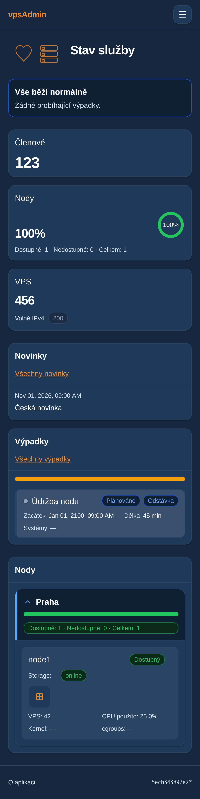
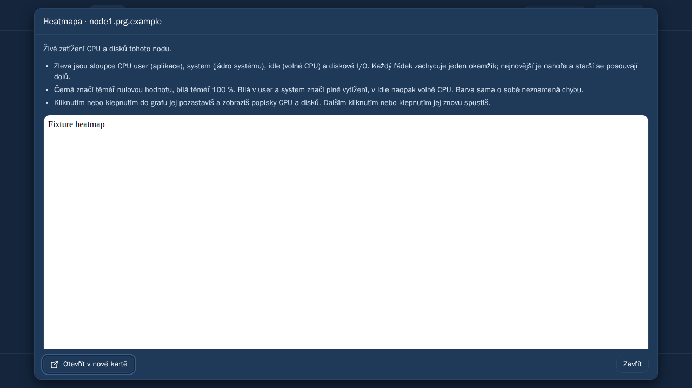
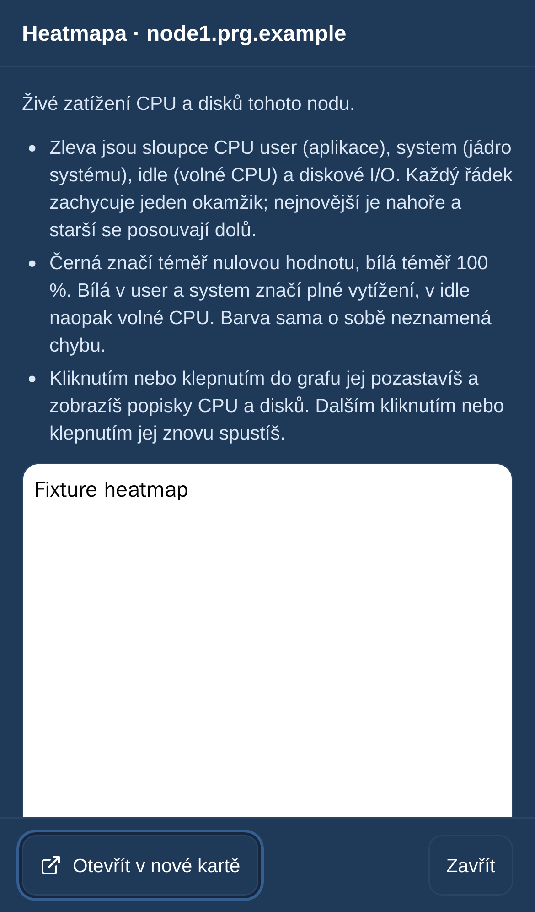

# Public overview spacing and explanations — 1 November 2026

Prepared for review in PR124, following the maintainer's public overview feedback.
No merge, API change or live deployment. REQ-054.

Use the smaller shared 12px alert inset for public card headers, bodies and
statistics. The shared Card/Alert/Badge defaults elsewhere remain unchanged;
StatCard accepts an optional body class for this scoped density choice. Badges
are deliberately small status labels with wider horizontal padding, not cards.
Remove the overview intro and redundant card subtitles instead of filling optional
text slots. Preserve metric calculations, meaningful status/error messages, news
language selection, outage summaries, dates and external heatmap eligibility.

Heatmap help now explains columns, history direction, percentage endpoints,
why white idle means free CPU and how to pause to see CPU/disk labels. Verified
against the project author's announcement and goresheat source revision
cfbfe7fd292d2e640dd3775c216b7e48ca4f497a (index.html history.unshift, CPU sections,
fragment colors and togglePause), without changing or embedding external code:
https://discourse.vpsfree.cz/t/254
https://github.com/snajpa/goresheat/blob/cfbfe7fd292d2e640dd3775c216b7e48ca4f497a/index.html

English/Czech catalogs follow the locked vpsAdmin terminology guide revision
a65a4dfeb92a59df4a80a737a20bcbf8558793ff and its localization procedure.
The external KB capture checkout remains unavailable; its screenshots/contracts
are not certified by these application checks.

## Verification

Pinned Node 24 on the remote Linux development runner: production build,
ci:quick (catalog parity/terminology, lint, formatting, design docs, TypeScript
including the new E2E source) and eight focused unit checks pass. StatCard was
adopted into the existing strict ESLint/Prettier coverage rather than updating
its deferred-source hash. The new browser spec is registered in strict E2E type
coverage and the mobile-WebKit allowlist.

Served production bundle, zero retries:
- 12 overview readability cases: cs/en × light/dark × desktop Chromium/mobile
  Chromium/mobile WebKit, empty and planned-outage layouts, equal 12px computed
  insets, no redundant subtitles or document overflow, guide wording, iframe
  lazy loading and removal on close.
- Six existing anonymous overview/news language regressions.
- Four existing desktop/mobile Chromium overview checks, including IPv4 alert,
  public request headers, grouping, collapsing and keyboard focus.
- Six existing admin-node heatmap regressions across all three projects,
  including eligibility, localized accessible labels, iframe URL, external link,
  opening/closing and keyboard focus restoration.
Total: 28 browser checks passed. Public API fixtures are synthetic; this is not a
live API authorization audit. No Playwright browser ran on the Mac.

The prior served bundle fails the new subtitle-removal assertion as expected.
Initial preparatory runs exposed missing strict-file adoption and a write denied
by the capability-limited runner when formatting an imported file. Coverage was
registered and only that owned file's ownership corrected; no rule or assertion
was weakened. WebKit's explicit file allowlist was extended before its four
new cases were run. Evidence is retained in remote
`evidence/public-news-20261101/readability-*` logs/output. All 1,434 local tracked
source-file hashes match the remote built source; capture footers show the older
checkout base plus dirty marker because the bundle was built before committing.

The implemented UI below uses synthetic data and an explicitly labeled external
heatmap stub, served only on loopback on the development machine. It is not a
live-site deployment. Green badges deliberately keep compact pill geometry.

