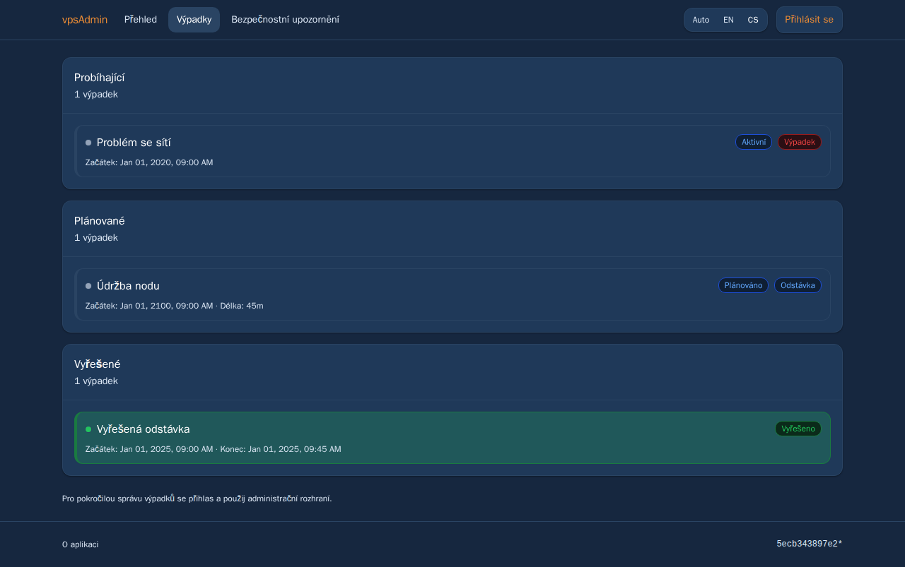
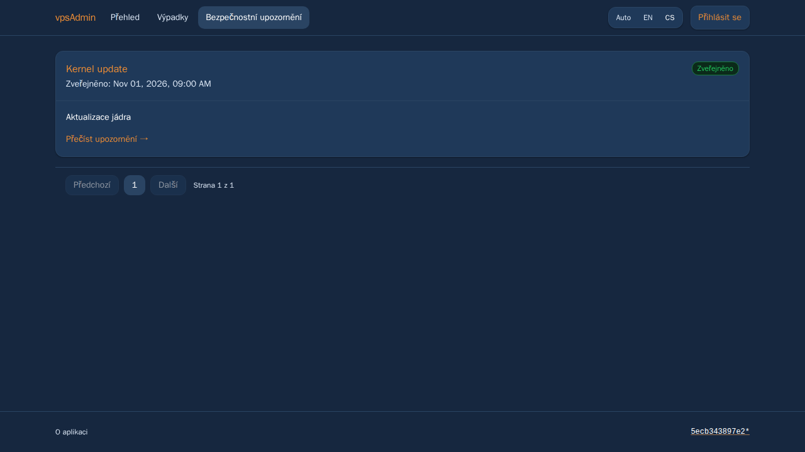
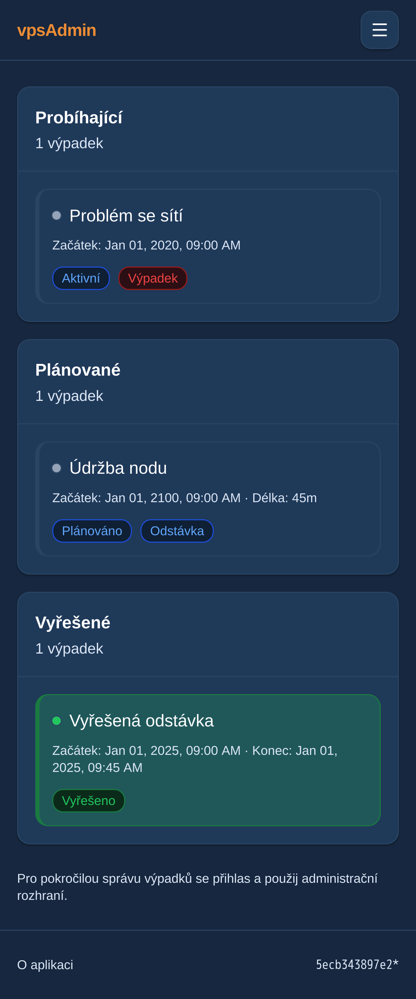
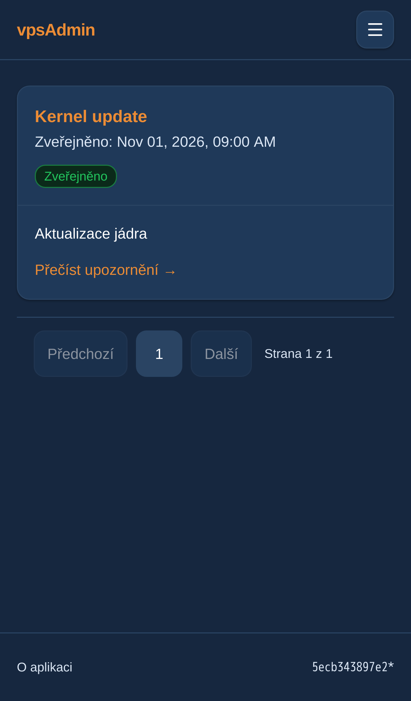

# Public overview spacing and explanations — 1 November 2026

Prepared for review in PR124, following the maintainer's public overview feedback.
No merge, backend API change or live deployment. REQ-054.

Use the smaller shared 12px alert inset for public card headers, bodies and
statistics. The shared Card/Alert/Badge defaults elsewhere remain unchanged;
StatCard accepts an optional body class for this scoped density choice. Badges
are deliberately small status labels with wider horizontal padding, not cards.
Remove the overview intro and redundant card subtitles instead of filling optional
text slots. Preserve metric calculations, meaningful status/error messages, news
language selection, outage summaries, dates and external heatmap eligibility.

Heatmap help now explains columns, history direction, percentage endpoints,
why white idle means free CPU and how to pause to see CPU/disk labels. Verified
against the project author's announcement and goresheat source revision
cfbfe7fd292d2e640dd3775c216b7e48ca4f497a (index.html history.unshift, CPU sections,
fragment colors and togglePause), without changing or embedding external code:
https://discourse.vpsfree.cz/t/254
https://github.com/snajpa/goresheat/blob/cfbfe7fd292d2e640dd3775c216b7e48ca4f497a/index.html

English/Czech catalogs follow the locked vpsAdmin terminology guide revision
a65a4dfeb92a59df4a80a737a20bcbf8558793ff and its localization procedure.
The external KB capture checkout remains unavailable; its screenshots/contracts
are not certified by these application checks.

## Verification

Pinned Node 24 on the remote Linux development runner: production build,
ci:quick (catalog parity/terminology, lint, formatting, design docs, TypeScript
including the new E2E source) and eight focused unit checks pass. StatCard was
adopted into the existing strict ESLint/Prettier coverage rather than updating
its deferred-source hash. The new browser spec is registered in strict E2E type
coverage and the mobile-WebKit allowlist.

Served production bundle, zero retries:
- 12 overview readability cases: cs/en × light/dark × desktop Chromium/mobile
  Chromium/mobile WebKit, empty and planned-outage layouts, equal 12px computed
  insets, no redundant subtitles or document overflow, guide wording, iframe
  lazy loading and removal on close.
- Six existing anonymous overview/news language regressions.
- Four existing desktop/mobile Chromium overview checks, including IPv4 alert,
  public request headers, grouping, collapsing and keyboard focus.
- Six existing admin-node heatmap regressions across all three projects,
  including eligibility, localized accessible labels, iframe URL, external link,
  opening/closing and keyboard focus restoration.
Total: 28 browser checks passed. Public API fixtures are synthetic; this is not a
live API authorization audit. No Playwright browser ran on the Mac.

The prior served bundle fails the new subtitle-removal assertion as expected.
Initial preparatory runs exposed missing strict-file adoption and a write denied
by the capability-limited runner when formatting an imported file. Coverage was
registered and only that owned file's ownership corrected; no rule or assertion
was weakened. WebKit's explicit file allowlist was extended before its four
new cases were run. Evidence is retained in remote
`evidence/public-news-20261101/readability-*` logs/output. All 1,434 local tracked
source-file hashes match the remote built source; capture footers show the older
checkout base plus dirty marker because the bundle was built before committing.

The implemented UI below uses synthetic data and an explicitly labeled external
heatmap stub, served only on loopback on the development machine. It is not a
live-site deployment. Green badges deliberately keep compact pill geometry.

## Heading and summary alignment follow-up

The maintainer requests removal of duplicated visible headings on overview,
outage and security-advisory lists; preserve an h1 for screen-reader navigation.
Move the existing heart/server mark into the summary row at its left (above
cards on narrow screens), use equal-width standard cards and remove the node
ring, which had shifted its value lower. All metric values now use the same
font size and baseline; node percentage/counts, free IPv4 and alerts remain.
Detail pages, routing, navigation and API contracts are unchanged.
New browser assertions cover heading clipping, absence of circles, equal widths,
value font/baseline geometry and brand position.

Follow-up verification on the same remote pinned Linux runner: ci:quick,
12 focused unit tests (six public/i18n test files) and production build pass.
The previous bundle fails the h1 screen-reader-only assertion as expected.
The updated served bundle passes 22 browser checks with zero retries: 12
cs/en × light/dark × desktop/mobile Chromium/mobile WebKit readability flows,
six existing news-language cases and four existing public overview checks.
Each readability flow also visits the outage and advisory lists, waits for
real fixture content, verifies that the accessible h1 occupies at most 1px,
and captures the page. Desktop checks measure equal card widths, 24px values,
matching value baselines within 1px and the mark wholly left of the cards.
The ring has no SVG circle remaining in the summary. Mobile is overflow-free.
Evidence: remote `evidence/public-news-20261101/summary-row-{before,after,checks}`.
No browser ran on the Mac and no live release changed. The figures above now
show this follow-up; earlier numeric results describe their earlier checkpoint.

## Information-priority follow-up

The maintainer requests this public order: outages (when present), news,
security advisories, nody, members. Render one vertical DOM order on all screen
sizes. Current and planned outages coexist; unclassified rows remain visible,
and resolved records appear only at the very bottom. Remove the nominal banner
and duplicate compact node-percentage tile. Keep the detailed node status and
bottom aligned member/VPS stats with the existing mark. Split the former coupled
news/outage component into small independent cards; keep news selection intact.

Add a five-row published-advisory preview using the credential-free public
transport, exact state/newest/limit parameters and defensive filtering/sorting.
No draft/retracted content, auth headers, CVE fan-out or private affected-object
lookups belong in this preview. Keep separate loading/error/empty states and
links to the existing full public archive/details. API/schema/roles unchanged.
Terminology revision remains a65a4dfeb92a59df4a80a737a20bcbf8558793ff; no
external KB contract is claimed.

Information-priority verification on the remote pinned Linux runner: ci:quick,
regenerated design inventory (no inventory diff), 19 focused unit checks across
eight files and production build pass. Public-helper coverage seeds a session
sentinel and verifies no authorization headers, exact published/newest/limit
query parameters, draft/retracted filtering, ordering and a five-row cap. Outage
unit cases cover absence, mixed current/planned/unclassified rows, a bounded
resolved preview and explicit pending/error states.

The preceding bundle fails the new advisory-preview assertion (block absent).
The updated served bundle passes 28 browser cases with zero retries: 12
cs/en × light/dark × desktop Chromium/mobile Chromium/mobile WebKit readability
flows; six existing news locale checks; four original overview checks; and six
new independent outage/advisory failure cases. Readability flows assert the
actual vertical DOM order, mixed live/planned records at the top, resolved-only
preview last, empty outage sections hidden, absence of the nominal banner and
draft data, 12px padding, consistent bottom-member/VPS geometry, no overflow,
heatmap interaction and other public pages. Failures do not hide healthy news
or statistics. All source comes from the task checkout; synthetic feature data
is not a live API authorization audit. Evidence:
`evidence/public-news-20261101/information-order-{before,after,checks}`.

The captures above now reflect this current order, with empty outages in the
light desktop image and mixed ongoing/planned/resolved fixtures in the dark and
mobile images. Earlier counts/layout descriptions are checkpoint history.
Public/API scope, existing detail/archive pages and shared UI defaults remain
unchanged; this feature is still only prepared in PR124, not merged/deployed.
