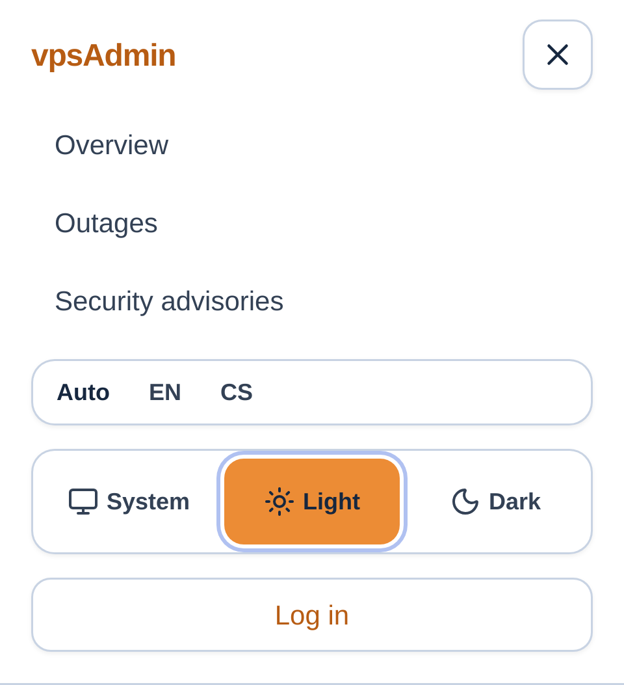

# Anonymous theme selection — 1 November 2026

Status: prepared and locally verified for review; no merge or deployment. REQ-005/009.
The maintainer reports that an anonymous visitor cannot choose a theme. The
existing settings/theme providers support local preferences, but PublicLayout
only exposes language. Add one small shared icon control in the public header
and labeled choices in the small-screen menu. Reuse existing translated labels,
aria-pressed, visible focus and 44px coarse-pointer targets. Move full navigation
to the large-screen breakpoint so tablet widths do not overflow.

The change uses the existing UiSettingsProvider local storage path; anonymous
visitors do not read or write private server settings. Authenticated preference
synchronization, theme bootstrap and system media handling are unchanged.

Terminology was read from locked vpsadmin input
a65a4dfeb92a59df4a80a737a20bcbf8558793ff. Existing en/cs theme labels are reused.
The effective deployed API/terminology input remains separate; no API/input
update is included. The external vpsadmin-kb-captures checkout/workflow was not
available in this workspace; external KB screenshots are not certified current.

Verification plan: reproduce on current dev; exercise anonymous switching,
reload persistence, system color changes, no private settings requests and
320/768/1280px overflow in desktop Chromium/mobile Chromium/mobile WebKit on
the remote development runner. Record implemented synthetic desktop/mobile
captures and exact completed checks before publishing the review.

## Verification

The current dev release 70bd11d9 fails both 320px Chromium/mobile WebKit
regressions because the public theme choices do not exist. The implemented
control passes all nine cases across desktop Chromium/mobile Chromium/mobile
WebKit at 320/768/1280px, with zero retries: local light/dark/system selection,
visible and accessible selected state, reload persistence, system color changes,
no private settings requests and no document overflow.

Fresh pinned Linux dependencies, ci:quick, 14 focused PublicLayout/settings unit
tests and the production build pass. An initial strict config formatting failure
was corrected with the pinned formatter. The initial staging nginx could not
traverse the intentionally private runner directory; only public dist files were
copied to an owned static staging root, leaving runner permissions unchanged.
Failed harness output is retained; no application guard or assertion was relaxed.

The images below capture implemented synthetic public UI on remote staging;
they are not production deployment evidence. No API, BFF, dependency, private
setting or host configuration change is included.

