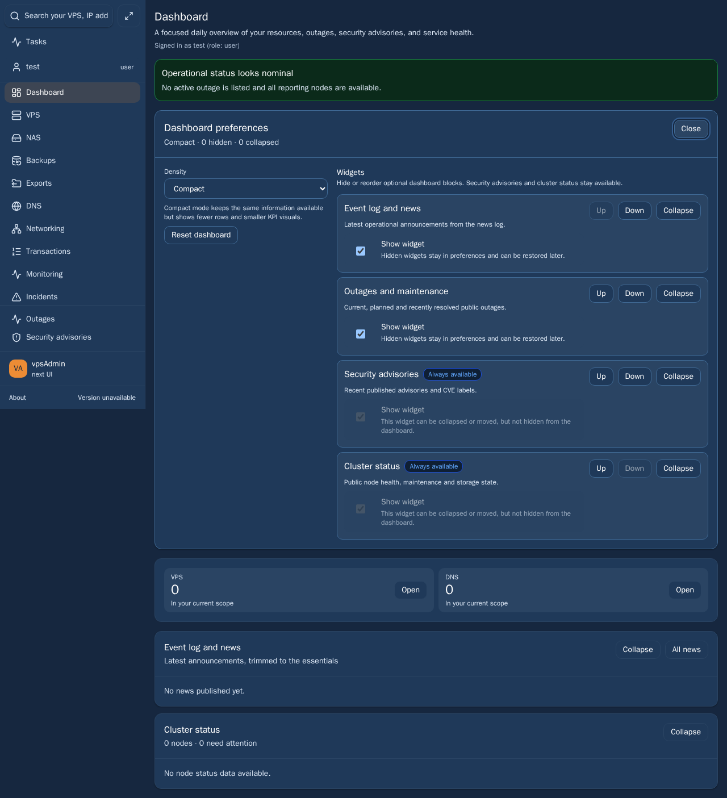
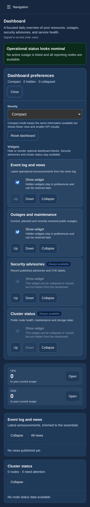

# UX-04: distinguish dashboard editor groups

The maintainer authorized approved TODO work and preview deployments, without
PR approvals, merges or newadmin deployment. UX-04 is bounded to the dashboard
widget editor shown in the original feedback, not a global palette change.

The open dark editor's border/surface contrast reproduces at 1.18:1, and its
widget titles are generic medium-weight body text. Reuse the existing stronger
semantic border token for this editor's boundary, separator, widget groups,
select and buttons. Add an h2 editor title and h3 semibold widget titles, with
smaller explanatory text. Preserve every setting, essential-widget restriction,
focus/disclosure behavior and touch target. No new color or localization key.

The new regression fails before the fix at the editor border. Its thresholds
measure group separation (2:1 outer, 1.6:1 inner), not WCAG certification of the
whole application. Explanatory text must still meet 4.5:1. It also checks
heading hierarchy and overflow in cs/en and light/dark. The existing responsive
focus/touch spec is now explicitly included for WebKit and adopted into the
strict E2E type inventory; its mobile detection includes both mobile engines.

## Verification

- Focused remote browser checks: 15 passed, 0 failed, no retries; desktop
  Chromium, mobile Chrome and mobile WebKit.
- `npm run ci:quick` passed (including strict E2E adoption, typechecks,
  design documentation, localization, mutation and structural audits).
- `npm run build` passed. The final dark desktop/WebKit captures were refreshed
  from the top of the document, with both geometry checks passing.

- PR and preview activation: not yet performed; this is prepared work.

## Scope, documentation and release limits

TODO decisions were read at revision 14; approvals, comments and completion
remain untouched. Requirements: REQ-009, REQ-010. Base: `13a39a58` on
`kerrycek-021126`; main, colleagues' PRs and held DNS changes are excluded.
Locked terminology reference read: vpsadmin `a65a4dfeb92a59df4a80a737a20bcbf8558793ff`.
No UI wording changes. The linked KB workflow describes legacy vpsAdmin input
pins; do not pin that API/legacy input to a React WebUI commit. This work does
not publish KB pages or claim external documentation/screenshot currency.
Screenshots below, when present, use synthetic member data on the pinned
server runner. They are implemented UI evidence, not a real API audit.

The live TODO report and canonical continuity record retain full paths to
private run artifacts and the known dependency/TLS/mailer limitations.

## Implemented UI screenshots (synthetic member fixtures)

## CI follow-up: exact page heading

The first remote mobile-Chrome PR smoke completed 593 cases and failed the
existing authenticated-home smoke: its substring `Dashboard` heading matched
both the page h1 and the newly semantic `Dashboard preferences` h2. Use the
exact level-1 page title and retain every navigation, identity and KPI assertion.
Add this existing smoke to the WebKit selection. All six focused cases passed
against the same compiled runtime in Chromium, mobile Chrome and mobile WebKit
with zero retries. The failed CI job and original logs remain available. This
follow-up changes test targeting only; it does not remove the semantic h2.
