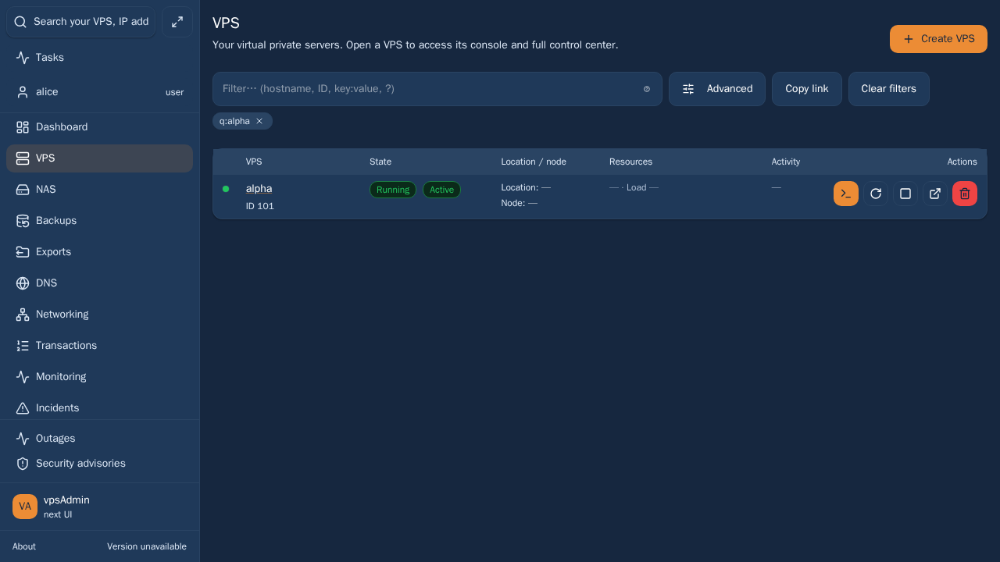
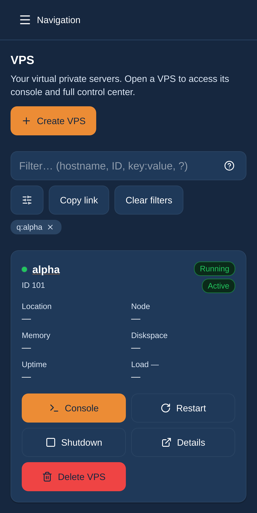

# UX-03: align the VPS filter controls

The maintainer authorized implementing approved TODO proposals as separate PRs
against `kerrycek-021126`, with dev/clankerdev previews and no PR approval,
merge or newadmin deployment. UX-03 is bounded to the VPS list filter row.

The untouched source reproduces a 44 px smart input beside 32 px advanced,
copy-link and clear buttons on desktop. Align only those adjacent buttons to
44 px while retaining compact labels, the embedded help action, filter chips,
URL behavior and all other lists. This also preserves mobile touch targets.

The new geometry regression fails before the fix (expected 44, got 32). It
covers cs/en and light/dark alongside existing chip order and overflow checks.
All 21 cases passed in desktop Chromium, mobile Chrome and mobile WebKit.
WebKit now explicitly includes this existing spec. No API behavior changes.

## Verification

- Focused remote browser checks: 21 passed, 0 failed, no retries; desktop
  Chromium, mobile Chrome and mobile WebKit.
- `npm run ci:quick` passed (including strict E2E adoption, typechecks,
  design documentation, localization, mutation and structural audits).
- `npm run build` passed.

- PR and preview activation: not yet performed; this is prepared work.

## Scope, documentation and release limits

TODO decisions were read at revision 14; approvals, comments and completion
remain untouched. Requirements: REQ-073, REQ-010. Base: `13a39a58` on
`kerrycek-021126`; main, colleagues' PRs and held DNS changes are excluded.
Locked terminology reference read: vpsadmin `a65a4dfeb92a59df4a80a737a20bcbf8558793ff`.
No UI wording changes. The linked KB workflow describes legacy vpsAdmin input
pins; do not pin that API/legacy input to a React WebUI commit. This work does
not publish KB pages or claim external documentation/screenshot currency.
Screenshots below, when present, use synthetic member data on the pinned
server runner. They are implemented UI evidence, not a real API audit.

The live TODO report and canonical continuity record retain full paths to
private run artifacts and the known dependency/TLS/mailer limitations.

## Implemented UI screenshots (synthetic member fixtures)

